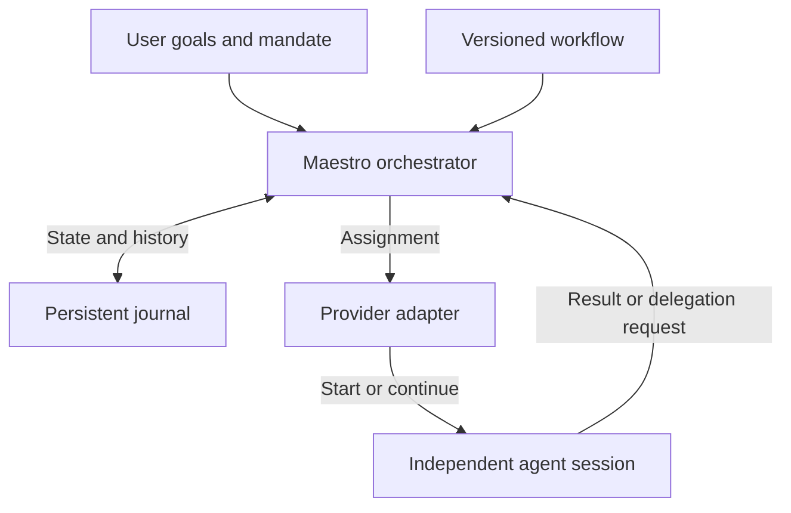

# Maestro and agent-loop orchestration

Technical vision for independent workflows over independent agent sessions

DSpatch • 13 September 2026 • Version 1.1 — English edition

## 1 Purpose and guiding principle

**Maestro owns the workflow, role relationships and project state. Provider adapters supply agent execution.** Each participant in our network can run as an independent main agent with Cursor, Copilot or a future provider. Maestro represents the relationship when one agent works for another.

This lets the same work structure use different agent engines and lets project needs determine its logical depth. Each loop step has a clear connection to its runs, results and usage. Providers' internal subagents may help execute an assignment without defining our loop structure.

This elaborates [DSpatch's governing vision](VISION.md), particularly sections 4, 7–9 and 14. The principle above is the selected direction here; the data model, interfaces and implementation increments below are technical proposals to test. Maestro is an internal working name.

The external Cursor loop currently helping us build DSpatch is described in [DEVELOPMENT_LOOP.md](DEVELOPMENT_LOOP.md). That is a separate development aid. This vision concerns orchestration later built into the product. The first useful chat and DSP-1–6 retain their scope.

## 2 Distinct concepts

| Concept | Meaning in Maestro |
| --- | --- |
| Role | Responsibilities and instructions, such as Researcher or Reviewer. A role does not fix a model. |
| Task | An intended result with a goal, boundaries and criteria. May contain subtasks. |
| Loop step | An occurrence of planning, implementation, review or another workflow activity. |
| Attempt | One execution of a step. Rework gets its own identity and preserves previous results. |
| Session | The provider's conversation and execution context. May be reused when appropriate. |
| Run | A bounded invocation within a session, with a start, events and termination reason. |
| Internal subagent | An agent started by the provider's agent engine within an assignment. |

A task may pass through several steps and attempts. A step may require multiple calls, and several sessions may perform the same role. Neither a role name nor a session ID should therefore identify a project task.

**Logical depth, native subagent depth, concurrency and iteration count are different.** Our task hierarchy may be deep even when one central orchestrator calls all SDK sessions. Maestro needs its own work and resource limits; account and provider limits still apply.

## 3 Architectural responsibilities

The workflow defines steps, how results are assessed and when the next step may start. Maestro's code registers work, drives state transitions and enforces the mandate. An Executive or Planner agent may propose priorities and delegation, but proposals are validated before becoming scheduled work.

Figure 1. Example of responsibilities and feedback for one step. A workflow can include several such sessions.

The orchestrator must be able to run without keeping a particular chat window open. In the selected TypeScript, React and Electron stack, agent work and heavy operations run outside the rendering thread. The UI displays persisted project state and streaming updates.

An adapter reports support for start, streaming, cancellation, resumption, model selection, approvals and cost. It maps provider events to shared concepts while retaining relevant raw references. Unsupported functionality must be expressible without the rest of the model pretending it exists.

## 4 Example of logically nested work

Suppose the task is to understand why zooming during playback freezes an audio application. This illustrates the workflow; it establishes no real bug cause.

1. **Tech Lead** receives the goal, reproduction steps and code reference in session A. It proposes investigating interactions between events and rendering.
2. **Maestro** registers research as a subtask, associates it with its requester and starts **Researcher** in session B. The Tech Lead's continuation waits for the result.
3. The Researcher needs a measurement. Maestro registers an experiment as its subtask and starts **Implementer** in session C with a bounded write scope.
4. Separate steps review and verify the result. Measurements, diff and test outcomes reference the actual code version used.
5. Maestro returns the experiment report to the Researcher, which weighs it against the hypotheses. It then returns the research result to the Tech Lead.
6. The Tech Lead proposes a correction or replanning. The user can follow the reasoning and intervene at any level.

The Tech Lead–Researcher–Implementer relationship lives in Maestro's tasks and handoffs. A, B and C are independent provider sessions. To make this logically equivalent to subagent collaboration, we must manage waiting, context, result delivery and continuation ourselves.

A delegation request may be a structured tool call or a validated part of an agent response. It should specify the goal, result format and boundaries. Maestro adds trusted identities, checks permissions and budget, and queues the work. A parent can release execution capacity while waiting; child work must not stall because waiting parents occupy every slot.

## 5 Context and persistent information

Each assignment receives bounded context: current goal version, relevant plan, code reference, earlier decisions, necessary reports and applicable mandate. Results state what was done, supported conclusions, available evidence and remaining work. References to larger evidence avoid copying the entire project chat at every delegation.

Proposed stable identities cover project, task, workflow version, loop step, attempt and run. Associate each run with provider session/call IDs, requested and observed model, working copy, timestamps and termination reason. Usage records and verification results reference these identities.

Project-owned history enables model or provider changes. A provider session cannot be assumed to transfer intact to another provider. On a switch, Maestro builds new context from saved decisions and evidence and makes the handoff explicit.

A separate session does not automatically provide independent review. The Reviewer needs a clear assignment, correct revision and evidence to challenge the implementer's conclusions. Parallel changes use isolated working copies; after integration, verify the combined revision.

## 6 State and recovery

**Register work before starting it.** After checking the task, dependencies and mandate, mark the selected step active, save its focus and register an attempt before invoking the provider. Kanban and reports should reflect this immediately. Board status is a view of the work; by itself it does not prove a process is still running.

States need to distinguish queued, running, awaiting child results, awaiting the user, under review, complete, failed, cancelled and unknown outcome. Exact names may change. An agent response does not mean the task's criteria are met.

On timeout or process crash, preserve the last reliable observation. Maestro then reconciles provider status, working-copy contents and existing results before possibly retrying. A new call must not silently duplicate a job or reapply a change. When an API lacks idempotency or reliable reconnection, expose the unknown outcome.

Events and handoffs need stable IDs to recognise duplicate delivery. The first implementation may have one writing orchestrator; a distributed execution engine is not a prerequisite. No database or full event-sourcing architecture is selected here.

Pause should prevent new starts and wait for or cancel active work according to the chosen policy. Cancellation also tracks affected subtasks, SDK runs and terminal processes. Sending a cancellation command is a request; the UI shows whether termination is confirmed or unknown. Resume preserves counters, costs and earlier attempts.

## 7 Providers' internal subagents

A provider may split work such as code search among its own subagents. This can be useful while Maestro owns the overall workflow. Show that internal activity under the responsible run; it does not automatically change the project plan or create logical loop steps.

Maestro should be able to allow or disable internal delegation per assignment where the adapter supports this. The responsible run retains its mandate and budget. Display only internal activity actually exposed by the provider; do not assume a complete internal agent graph is available.

Cursor documents independent persistent agents and a dispatcher pattern. Its native subagent feature limits nesting to two subagent levels below the main agent. Local SDK execution can disable internal delegation with `disallowedTools: ["task"]`; restrictions must be supplied again on `Agent.resume()`. This is documented support, not an integration test performed in DSpatch. [Cursor SDK](https://cursor.com/docs/sdk/typescript)

Copilot SDK documents independent sessions and uses Copilot CLI as its runtime. VS Code's native subagent limit must therefore not be treated as a general SDK limit. [Copilot SDK](https://github.com/github/copilot-sdk), [independent sessions](https://github.com/github/copilot-sdk/blob/main/nodejs/README.md#multiple-sessions)

## 8 Cost per loop step and attempt

**Owning orchestration makes cost easier to attribute to the right work.** Before starting a call, Maestro already knows its task, step and attempt. Research, planning, implementation, review and rework get distinct records. Model-based coordination and report compilation count too.

A session dedicated to a step creates a clear accounting boundary. Reusing a session across steps requires call-specific values or reconciled differences between cumulative measurements. Differences are reliable only when measurement scope is known and concurrent or delayed activity does not contaminate them. Ambiguous amounts remain unallocated or provisional.

### What to record

Each record should identify source, unit, measurement scope, observation time, provider reference and attempt. Preserve original precision; round only for presentation. Distinguish reported usage, provisional values, price-based estimates and actual charges. Missing cost is unknown, never zero.

**Use AI credits when the provider reports them with a defined meaning.** Tokens, premium requests and money are separate measures. Do not sum different providers' credits as one currency without documented comparability. Show any conversion separately with its rule and date.

Copilot SDK documents `session.rpc.usage.getMetrics()` with cumulative usage including internal subagents. `totalNanoAiu` measures nano-AI units; its example divides by one billion for AI credits, but the documentation requires checking the current billing definition. The API is experimental, and the experiment needs pinned SDK and CLI versions. `assistant.usage.cost` is described as a premium-request multiplier and must not be confused with AI credits. This live event is not replayed on resume, motivating independent accounting and reconciliation against totals. [Copilot SDK usage](https://github.com/github/copilot-sdk/blob/main/docs/features/usage-and-billing.md)

Cursor documents `Agent.getUsage()` with tokens and costs in US cents. Local execution is broken down by turn and cloud execution by run; provider IDs must map to our attempts. Cost may arrive later, and `chargedCents: 0` may represent included usage. It does not establish zero consumption. The Cursor adapter therefore cannot assume a common AI-credit unit. [Cursor SDK cost](https://cursor.com/docs/sdk/typescript#agentgetusage)

### Aggregate without double counting

A step's direct cost is the sum of its own attempts. A whole task also includes its logical subtasks, counted once each. Several tasks may reference shared research, but each cost record counts only once in the project total. Make any allocation policy explicit.

When a session total already includes internal subagents, their detail is a breakdown of that total, not an addition. Cumulative readings replace or reconcile earlier readings for the same scope; every reading is not a new charge. Late corrections retain traceability to earlier reports.

This arithmetic example assumes one provider, one credit definition and complete reporting. These are illustrative values, not prices or measurements.

| Loop step | Attempt | AI credits | Note |
| --- | --- | --- | --- |
| Planning | 1 | 0.4 | Separate call |
| Research | 1 | 1.2 | Includes 0.3 from an internal subagent |
| Implementation | 1 | 2.0 | First candidate |
| Review | 1 | 0.6 | Requests rework |
| Implementation | 2 | 0.8 | Corrected candidate |
| Verification | 1 | 0.5 | Agent call for verification |
| Total | 6 attempts | 5.5 | Internal 0.3 already included |

Budget control can combine reported usage with reservations for active work. Delayed values and cancellation latency mean a local budget check is not automatically an exact billing cap. Report external experiment and compute costs separately from agent credits.

## 9 Human direction and understandable overview

The whole project can remain interactive as long as the user wants. In autonomous mode, the same steps may run within an agreed mandate with executive-level reporting. Switching preserves goals, decisions, history and costs and explicitly handles active work.

Reports show achievements, current plan, open questions, usage and next steps. Questions appear as copyable text with a recommendation, when an answer is needed and what can continue. Silence is not approval, but deferrable questions must not stop authorised work.

Make it easy to understand who works for whom, why a step is waiting and what rework cost. Drill-down reveals rationale, diff, relevant surrounding code and evidence for the correct revision. Technical agent/session IDs support troubleshooting without dominating the user workflow.

Automated tests assess many functions. Clarity, responsiveness and manual code review also need user trials. Many autonomous steps or low cost do not establish a good working method.

## 10 Useful implementation increments

This sequence makes the later Maestro work concrete. It does not replace DSpatch's planned first milestone.

| Increment | Value and boundaries |
| --- | --- |
| Prepare in the chat integration | Separate adapter, session, run and saved history. Collect available usage. One agent is enough. |
| Two coordinated sessions | Implementer and Reviewer work sequentially on an identified candidate, returning results with stable references. |
| Persistent stepwise loop | Add planning, verification and rework with working pause and recovery. |
| Logical subtasks | Agents request work through Maestro and continue after child results. Test per-step cost allocation. |
| More working methods | Add isolated parallelism, a second provider and, for example, a review committee when they provide clear value. |

The first loop may be a small versioned definition and a simple runner. A graphical workflow builder, distributed infrastructure and large role library are needed only when they solve concrete problems. Sequential work simplifies debugging and cost reconciliation.

Later, model selection may adapt to task character, complexity, evidence requirements and budget. Save the selection rationale and the model actually reported. If rework uses a stronger model, compare both quality and total cost across attempts.

Versioned workflows must express feedback and cycles. Create identified step occurrences for each iteration so review can recur without overwriting history. New working methods may require contract extensions; not all future variation is predictable.

## 11 What a prototype must demonstrate

1. An agent requests a subtask executed in a separate session. The correct requester receives its result and continues with preserved context.
2. A logically nested example works without the provider's native subagent feature. Waiting steps do not consume capacity needed for execution.
3. Interruption after startup but before the final report leaves an understandable state. Restart reconciles the outcome before any repetition and preserves counters.
4. A step, a rework attempt and a run with internal delegation can be accounted for without double counting. Missing and delayed costs remain visible.
5. Compare reused and separate sessions for cost reconciliation. Explain differences from the provider report; use AI credits only after verifying unit and scope.
6. Switching between interactive and autonomous work preserves tasks, evidence and human decisions. The user assesses the overview.

When adding a second provider, test the same workflow through its adapter. Aim for a shared workflow with disclosed capability differences, not assumed identical execution or transferable internal context.

## 12 Sources and document status

[VISION.md](VISION.md) governs product direction. This is a separate elaboration. Version 1.0 was prepared against VISION 1.8; this English edition follows the project's language policy. Repository Markdown is the maintained source. The previously delivered Swedish Word export, `Maestro_orkestrering_vision_v1.docx`, represents version 1.0 and has not been regenerated for this language-only edition.

The following provider documentation was read on 13 September 2026. These are documented building blocks and limitations. DSpatch's integration, cost reconciliation and recovery still need verification against selected versions and account. Translation is not a new runtime verification.

- [Cursor TypeScript SDK](https://cursor.com/docs/sdk/typescript): agent lifecycle, dispatcher, custom tools, internal delegation and usage.
- [Copilot SDK](https://github.com/github/copilot-sdk): SDK relationship to the CLI runtime.
- [Copilot SDK for Node.js](https://github.com/github/copilot-sdk/blob/main/nodejs/README.md): independent sessions and tool integration.
- [Copilot SDK usage and billing](https://github.com/github/copilot-sdk/blob/main/docs/features/usage-and-billing.md): session metrics, live events, AI units and experimental interfaces.

Prototypes determine storage choices, session reuse, default budgets and internal-delegation policies. The architectural direction is for Maestro to preserve project identity and direct work through these changes.
