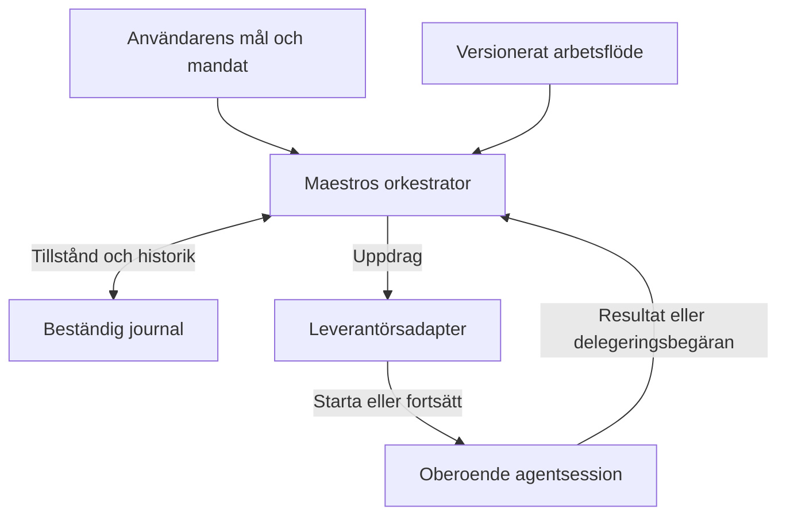

# Maestro och orkestrering av agentloopar

Teknisk vision för egna arbetsflöden över oberoende agentsessioner

DSpatch • 13 september 2026 • Version 1.0

## 1 Syfte och grundprincip

**Maestro ska äga arbetsflödet, rollrelationerna och projektets tillstånd. Leverantörsadaptrarna tillhandahåller agentkörningen.** Varje deltagare i vårt nätverk kan köras som en självständig huvudagent hos Cursor, Copilot eller en framtida leverantör. Att en agent arbetar åt en annan representeras i Maestro.

Det gör att samma arbetsstruktur kan användas med olika agentmotorer och att dess logiska djup kan bestämmas av projektets behov. Vi får också en tydlig koppling från varje loopsteg till dess körningar, resultat och förbrukning. Leverantörens interna subagenter kan användas som en del av utförandet, utan att definiera vår loopstruktur.

Dokumentet fördjupar [DSpatchs styrdokument](VISION.md), särskilt avsnitt 4, 7–9 och 14. Grundprincipen ovan är den valda riktningen i detta dokument; datamodell, gränssnitt och införandesteg nedan är tekniska förslag att pröva. Maestro är ett internt arbetsnamn.

Den externa Cursor-loop som nu hjälper oss bygga DSpatch beskrivs i [DEVELOPMENT_LOOP.md](DEVELOPMENT_LOOP.md). Den är ett separat utvecklingshjälpmedel. Denna vision gäller den orkestrering som senare byggs in i produkten. Första användbara chatten och DSP-1–6 behåller sin omfattning.

## 2 Begrepp som behöver hållas isär

| Begrepp | Betydelse i Maestro |
| --- | --- |
| Roll | Ansvar och instruktioner, exempelvis Researcher eller Reviewer. Rollen låser ingen modell. |
| Uppgift | Ett önskat resultat med mål, avgränsning och kriterier. Kan ha deluppgifter. |
| Loopsteg | Ett tillfälle då arbetsflödet exempelvis planerar, implementerar eller granskar. |
| Försök | Ett genomförande av steget. Ett omtag får egen identitet och behåller föregående resultat. |
| Session | Leverantörens konversation och körkontext. Kan återanvändas när det är lämpligt. |
| Körning | Ett avgränsat anrop i en session, med start, händelser och avslutningsorsak. |
| Intern subagent | En agent som leverantörens agentmotor själv startar inom uppdraget. |

En uppgift kan genomgå flera steg och omtag. Ett steg kan kräva flera anrop, och samma roll kan utföras av flera sessioner. Därför bör varken ett rollnamn eller ett sessions-ID vara projektets uppgiftsidentitet.

**Logiskt djup, inbyggt subagentdjup, samtidighet och antal iterationer är olika saker.** Vår uppgiftshierarki kan vara djup även om SDK-sessionerna anropas från samma centrala orkestrator. Maestro behöver egna gränser för arbete och resursåtgång; kontots och leverantörens begränsningar gäller fortfarande.

## 3 Ansvarsfördelningen i arkitekturen

Arbetsflödet anger vilka steg som finns, hur resultat bedöms och när nästa steg får starta. Maestros programkod registrerar arbete, driver tillståndsövergångar och verkställer mandatet. En Executive- eller Planner-agent kan föreslå prioriteringar och delegering, men förslagen valideras innan de blir schemalagt arbete.

Figur 1. Exempel på ansvar och återkoppling för ett steg. Flera sådana sessioner kan ingå i samma arbetsflöde.

Orkestratorn ska kunna köras utan att ett visst chattfönster hålls öppet. I det valda TypeScript-, React- och Electron-spåret ligger agentarbete och tunga operationer utanför renderingstråden. Gränssnittet visar projektets sparade tillstånd och strömmande uppdateringar.

En adapter redovisar stöd för start, strömning, avbrott, återupptagning, modellval, godkännanden och kostnad. Den översätter leverantörshändelser till gemensamma begrepp och bevarar relevanta råreferenser. Saknat stöd ska kunna uttryckas utan att resten av modellen låtsas att funktionen finns.

## 4 Ett exempel på logiskt nästlat arbete

Anta att uppgiften är att förstå varför zoomning under uppspelning fryser ett ljudprogram. Exemplet illustrerar arbetsformen och fastställer ingen verklig buggorsak.

1. **Tech Lead** får mål, reproduktionssteg och kodreferens i session A. Den föreslår en undersökning av samspelet mellan händelser och rendering.
2. **Maestro** registrerar research som deluppgift, kopplar den till beställaren och startar **Researcher** i session B. Tech Leads fortsättning väntar på resultatet.
3. Researcher behöver en mätning. Maestro registrerar experimentet som dess deluppgift och startar **Implementer** i session C med avgränsat skrivområde.
4. Resultatet granskas och verifieras i egna steg. Mätning, diff och testutfall kopplas till den kodversion som faktiskt användes.
5. Maestro återför experimentrapporten till Researcher, som väger den mot hypoteserna. Därefter återförs researchresultatet till Tech Lead.
6. Tech Lead föreslår en korrigering eller omplanering. Användaren kan följa resonemanget och ingripa på valfri nivå.

Relationen Tech Lead–Researcher–Implementer finns i Maestros uppgifter och överlämningar. A, B och C är självständiga leverantörssessioner. För att samarbetet ska bli logiskt likvärdigt med underagenter behöver vi själva hantera väntan, kontext, resultatleverans och fortsättning.

En delegeringsbegäran kan vara ett strukturerat verktygsanrop eller en validerad del av agentens svar. Den bör ange mål, resultatformat och avgränsning. Maestro kompletterar med betrodda identiteter, kontrollerar behörighet och budget och köar arbetet. Föräldern kan lämna ifrån sig körkapaciteten under väntan; ett barnjobb ska inte fastna för att alla körplatser upptas av väntande föräldrar.

## 5 Sammanhang och beständig information

Varje uppdrag får ett avgränsat sammanhang: aktuell målversion, relevant plan, kodreferens, tidigare beslut, nödvändiga rapporter och gällande mandat. Resultatet anger vad som gjordes, vilka slutsatser som stöds, vilket underlag som finns och vad som återstår. Länkar till större underlag gör att hela projektets chatt inte behöver kopieras vid varje delegering.

Föreslagna stabila identiteter är projekt, uppgift, arbetsflödesversion, loopsteg, försök och körning. Till körningen kopplas leverantörens sessions- och anrops-ID, begärd och observerad modell, arbetskopia, tidsstämplar samt avslutningsorsak. En förbrukningspost och ett verifieringsresultat refererar till dessa identiteter.

Projektets egen historik gör det möjligt att byta modell eller leverantör. En leverantörssession kan däremot inte förutsättas flyttas till en annan leverantör med sitt interna tillstånd intakt. Vid byte skapar Maestro ett nytt sammanhang från sparade beslut och underlag och redovisar överlämningen.

En separat session ger inte automatiskt en oberoende granskning. Reviewern behöver ett tydligt uppdrag, rätt revision och tillgång till evidens för att pröva utförarens slutsatser. Vid parallella kodändringar används avskilda arbetskopior; efter sammanföring verifieras den kombinerade revisionen.

## 6 Tillstånd och återhämtning

**Arbetet registreras innan det startas.** Efter kontroll av uppgift, beroenden och mandat sätts valt steg till pågående, fokus sparas och ett försök registreras före leverantörsanropet. Kanban och rapporter ska kunna visa detta direkt. Tavlans status är en vy av arbetet; den bevisar inte ensam att en process fortfarande kör.

Tillstånd behöver skilja mellan köat, körande, väntande på delresultat, väntande på användaren, under granskning, klart, misslyckat, avbrutet och okänt utfall. Exakta namn kan ändras. Att agenten har svarat innebär inte att uppgiftens kriterier är uppfyllda.

Vid timeout eller processkrasch sparas den senaste säkra observationen. Maestro kontrollerar sedan leverantörens status, arbetskopian och redan producerade resultat innan ett anrop eventuellt upprepas. Ett nytt anrop får inte tyst dubbelstarta ett jobb eller återapplicera en ändring. Där API:t saknar idempotens eller säker återanslutning måste okänt utfall synliggöras.

Händelser och överlämningar behöver stabila ID:n så att upprepad leverans kan kännas igen. Första implementationen kan ha en enda skrivande orkestrator; en distribuerad körmotor är inget grundkrav. Ingen specifik databas eller fullständig event sourcing låses här.

Paus ska kunna stoppa nya starter och invänta eller avbryta aktiva jobb enligt vald regel. Avbrott följer också berörda deluppgifter, SDK-körningar och terminalprocesser. Ett skickat avbrottskommando är en begäran; gränssnittet visar om stoppet är bekräftat eller fortfarande okänt. Räknare, kostnader och tidigare försök bevaras vid återupptagning.

## 7 Leverantörernas egna subagenter

En leverantör kan internt dela upp exempelvis kodsökning mellan egna subagenter. Det kan vara användbart även när Maestro äger det övergripande arbetsflödet. Den interna aktiviteten visas då under den ansvariga körningen och ändrar inte automatiskt projektplanen eller skapar nya logiska loopsteg.

Maestro ska kunna välja om intern delegering tillåts per uppdrag, när adaptern stödjer det. Den ansvariga körningen behåller sitt mandat och sin budget. Observationer om intern aktivitet måste visa vad leverantören faktiskt exponerar; en fullständig intern agentgraf kan inte förutsättas.

Cursor dokumenterar både separata beständiga agenter och ett dispatcher-mönster. Dess inbyggda subagentfunktion begränsar nästlingen till två subagentnivåer under huvudagenten. I lokal SDK-körning kan intern delegering spärras via `disallowedTools: ["task"]`; begränsningar behöver skickas igen vid `Agent.resume()`. Detta är dokumenterat stöd, inte ett genomfört integrationsprov i DSpatch. [Cursor SDK](https://cursor.com/docs/sdk/typescript)

Copilot SDK dokumenterar oberoende sessioner och använder Copilot CLI som körmotor. Därför ska VS Codes gräns för inbyggda subagenter inte behandlas som SDK:ts generella gräns. [Copilot SDK](https://github.com/github/copilot-sdk), [oberoende sessioner](https://github.com/github/copilot-sdk/blob/main/nodejs/README.md#multiple-sessions)

## 8 Kostnad per loopsteg och försök

**Egen orkestrering gör kostnaden lättare att hänföra till rätt arbete.** När Maestro startar ett anrop vet det redan vilken uppgift, vilket steg och vilket försök anropet tillhör. Research, planering, implementation, granskning och omtag får därmed egna poster. Även modellbaserad koordinering och rapportsammanställning räknas med.

En session knuten till ett steg ger en tydlig kostnadsgräns. När en session återanvänds över flera steg krävs anropsspecifika värden eller avstämda skillnader mellan ackumulerade mätningar. Sådana skillnader är bara tillförlitliga om mätningarnas omfattning är känd och inga andra samtidiga eller sena aktiviteter blandas in. Oklara belopp ska stå som ofördelade eller preliminära.

### Vad som bokförs

Varje post bör ange källa, enhet, mätomfattning, mättidpunkt, leverantörsreferens och koppling till försöket. Spara ursprunglig precision och avrunda först i presentationen. Skilj rapporterad förbrukning, preliminära värden, prisbaserade uppskattningar och faktiskt debiterat belopp. Saknad kostnad visas som okänd, aldrig som noll.

**AI credits används när leverantören rapporterar dem med definierad betydelse.** Tokenantal, premium requests och pengar är separata mått. Credits från olika leverantörer får inte summeras som en gemensam valuta utan dokumenterad jämförbarhet. En eventuell omräkning visas separat med regel och tidpunkt.

Copilot SDK dokumenterar `session.rpc.usage.getMetrics()` med ackumulerad förbrukning inklusive interna subagenter. `totalNanoAiu` är dess mått i nano-AI-enheter; exemplet delar med en miljard för AI credits, men dokumentationen kräver kontroll mot gällande faktureringsdefinition. API:t är experimentellt och SDK- och CLI-version behöver fixeras vid provet. Fältet `assistant.usage.cost` beskrivs som en premium request-multiplikator och ska inte förväxlas med AI credits. Livehändelsen återspelas inte vid resume, vilket motiverar egen bokföring och avstämning mot totalsummor. [Copilot SDK om förbrukning](https://github.com/github/copilot-sdk/blob/main/docs/features/usage-and-billing.md)

Cursor dokumenterar `Agent.getUsage()` med tokenförbrukning och kostnad i amerikanska cent. Lokal körning bryts ned per turn och molnkörning per run; leverantörens ID:n behöver kopplas till våra försök. Kostnaden kan komma senare, och `chargedCents: 0` kan avse inkluderad användning. Det bevisar inte noll förbrukning. En gemensam AI-credit-enhet är därför inget antagande i Cursor-adaptern. [Cursor SDK om kostnad](https://cursor.com/docs/sdk/typescript#agentgetusage)

### Summera utan dubbelräkning

Ett stegs direkta kostnad är summan av dess egna försök. Kostnaden för en hel uppgift omfattar dessutom dess logiska deluppgifter, räknade en gång vardera. Delade researchresultat kan refereras från flera uppgifter, men samma kostnadspost får bara räknas en gång i projektets total. Eventuell kostnadsfördelning redovisas uttryckligen.

Om SDK-sessionens total redan omfattar interna subagenter är deras detaljer en nedbrytning av totalen. De läggs inte på igen. Ackumulerade mätvärden ersätter eller stämmer av tidigare mätningar för samma omfattning; de behandlas inte som nya kostnader vid varje avläsning. Sena korrigeringar bevarar spårbarheten till tidigare rapporter.

Följande räkneexempel antar samma leverantör, samma credit-definition och fullständig rapportering. Värdena illustrerar bokföringen och är inga priser eller mätresultat.

| Loopsteg | Försök | AI credits | Anmärkning |
| --- | --- | --- | --- |
| Planering | 1 | 0,4 | Eget anrop |
| Research | 1 | 1,2 | Inkluderar 0,3 från intern subagent |
| Implementation | 1 | 2,0 | Första kandidat |
| Granskning | 1 | 0,6 | Begär omtag |
| Implementation | 2 | 0,8 | Korrigerad kandidat |
| Verifiering | 1 | 0,5 | Agentanrop för verifieringen |
| Totalt | 6 försök | 5,5 | Interna 0,3 ingår redan |

Budgetstyrning kan kombinera rapporterad förbrukning med reservationer för pågående arbete. Fördröjda värden och avbrottslatens innebär att en lokal budgetkontroll inte automatiskt är ett exakt debiteringstak. Externa experiment- och beräkningskostnader redovisas separat från agentens credits.

## 9 Mänsklig styrning och begriplig översikt

Hela projektet ska kunna drivas interaktivt så länge användaren vill. Vid autonom körning kan samma steg utföras inom ett överenskommet mandat, med rapportering på executive-nivå. Växlingen bevarar mål, beslut, historik och kostnader och hanterar pågående arbete uttryckligen.

Rapporten visar vad som uppnåtts, aktuell plan, öppna frågor, förbrukning och nästa steg. Frågor presenteras som kopierbar text med rekommendation, när svaret behövs och vad som kan fortsätta. Uteblivet svar utgör inget godkännande, men frågor som kan vänta ska inte stoppa arbete inom mandatet.

Översikten ska göra det lätt att förstå vem som arbetar åt vem, varför ett steg väntar och vad ett omtag kostade. Fördjupning leder till motiven, diffen, relevant omgivande kod och evidensen för rätt revision. Tekniska agent- och sessions-ID:n finns för felsökning utan att dominera användarflödet.

Automatiska tester kan bedöma många funktioner. Upplevelsen av tydlighet, respons och manuell kodgranskning behöver också prövas av användaren. Ett högt antal autonoma steg eller låg kostnad bevisar inte att arbetsformen är bra.

## 10 Införande i användbara inkrement

Denna ordning konkretiserar den senare Maestro-utvecklingen. Den ersätter inte DSpatchs redan planerade första milstolpe.

| Inkrement | Nytta och avgränsning |
| --- | --- |
| Förbered i chattintegrationen | Håll adapter, session, körning och sparad historik åtskilda. Samla förbrukning där den är tillgänglig. En agent räcker. |
| Två samordnade sessioner | Implementer och Reviewer arbetar sekventiellt på en känd kandidat. Resultat återförs med stabila referenser. |
| Beständig stegvis loop | Lägg till planering, verifiering och omtag, med fungerande paus och återhämtning. |
| Logiska deluppgifter | Låt agenter begära arbete via Maestro och fortsätta efter barnresultat. Prova kostnadsfördelning per steg. |
| Fler arbetsformer | Inför isolerad parallellitet, en andra leverantör och exempelvis en granskningskommitté när nyttan är tydlig. |

Första loopen kan vara en liten versionerad definition och en enkel körmotor. En grafisk flödesbyggare, distribuerad infrastruktur och ett stort rollbibliotek behövs först när de löser konkreta problem. Sekventiellt arbete underlättar både felsökning och kostnadsavstämning.

Modellval kan senare anpassas efter arbetets art, komplexitet, evidenskrav och budget. Spara varför en modell valdes och vilken modell som faktiskt rapporterades. Om en starkare modell används vid ett omtag ska både kvalitet och total kostnad för försöken kunna jämföras.

Versionssatta arbetsflöden behöver kunna uttrycka återkoppling och cykler. För varje iteration skapas identifierade stegtillfällen, så att samma granskningssteg kan återkomma utan att historiken skrivs över. Nya arbetsformer kan behöva utöka kontrakten; all framtida variation kan inte förutses.

## 11 Vad som behöver visas i en prototyp

1. En agent begär en deluppgift som utförs i en separat session. Rätt beställare får resultatet och fortsätter med bevarat sammanhang.
2. Ett logiskt nästlat exempel fungerar utan att använda leverantörens inbyggda subagentfunktion. Väntande steg blockerar inte nödvändig körkapacitet.
3. Ett avbrott efter start men före slutrapport lämnar ett begripligt läge. Omstart klarlägger utfallet före eventuell upprepning och bevarar räknarna.
4. Ett steg, ett omtag och en körning med intern delegering kan bokföras utan dubbelräkning. Saknade och sena kostnadsvärden förblir synliga.
5. Återanvänd session och separat session jämförs för kostnadsavstämning. Skillnader mot leverantörens rapport förklaras; AI credits anges först när enhet och omfattning är verifierade.
6. Byte mellan interaktivt arbete och autonom körning bevarar uppgifter, evidens och mänskliga beslut. Användaren bedömer översikten.

När en andra leverantör införs prövas samma arbetsflöde genom dess adapter. Målet är ett gemensamt arbetsflöde med redovisade skillnader i förmågor, inte ett antagande om identisk körning eller flyttbar intern kontext.

## 12 Källor och dokumentstatus

Produktens överordnade riktning finns i [VISION.md](VISION.md), version 1.8. Detta dokument är en separat fördjupning; Markdown-versionen i repot är original och Word-versionen återger samma sakliga innehåll.

Leverantörsdokumentationen nedan lästes den 13 september 2026. Den beskriver tillgängliga byggstenar och deras begränsningar. DSpatchs konkreta integration, kostnadsavstämning och återhämtning behöver fortfarande verifieras mot valda versioner och konto.

- [Cursor TypeScript SDK](https://cursor.com/docs/sdk/typescript) beskriver agentlivscykel, dispatcher, egna verktyg, intern delegering och förbrukning.
- [Copilot SDK](https://github.com/github/copilot-sdk) beskriver SDK:ts relation till CLI-körmotorn.
- [Copilot SDK för Node.js](https://github.com/github/copilot-sdk/blob/main/nodejs/README.md) beskriver oberoende sessioner och verktygsintegration.
- [Copilot SDK om förbrukning och fakturering](https://github.com/github/copilot-sdk/blob/main/docs/features/usage-and-billing.md) beskriver sessionsmått, livehändelser, AI-enheter och experimentella gränssnitt.

Konkreta datalagringsval, sessionsåteranvändning, budgetstandarder och regler för intern delegering fastställs genom prototyperna. Arkitekturriktningen är att Maestro bevarar projektets identitet och styr arbetet genom dessa förändringar.
