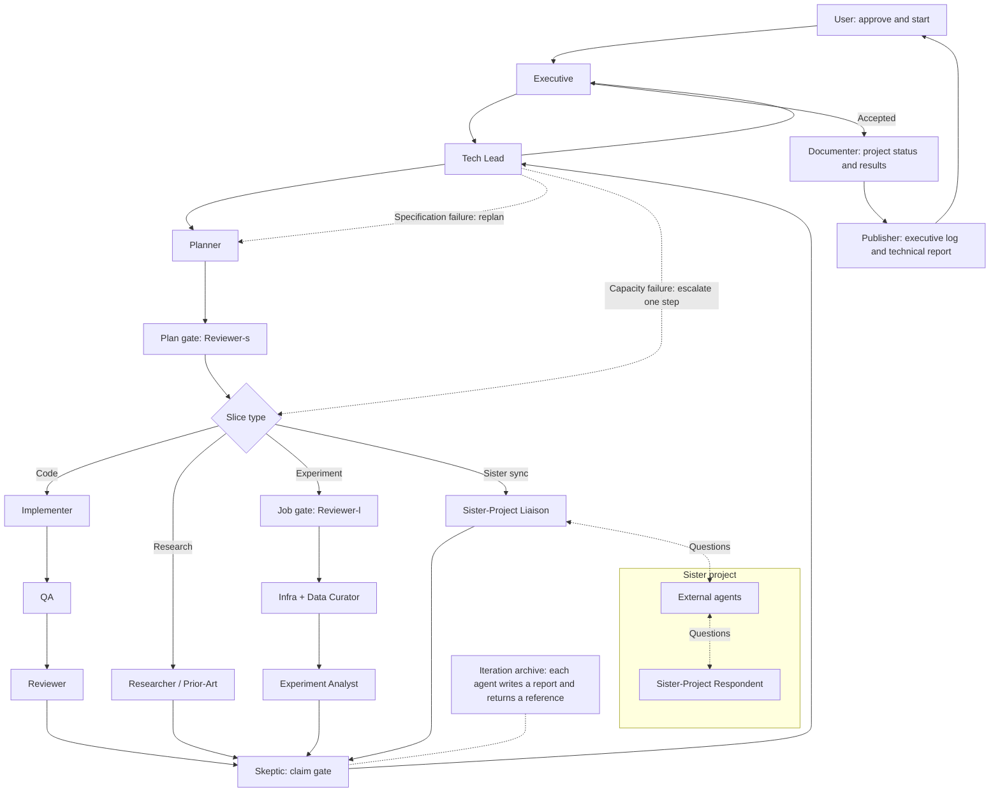

# DSpatch

Vision and governing document for agentic software development

Niclas Danielsson | 23 October 2026 | Version 1.11

Change in version 1.11: record Niclas's decision that review is a standalone capability that works from a repository and a chosen diff or revision (section 3.3). It gives no mandate for a separate app or a large rebuild.

Change in version 1.10: continue through DSP-6, then undertake bounded HCI and prior-art discovery and review the next direction with Niclas. Record five early review concepts as hypotheses. Phase 0's conventional diff remains a baseline and does not fix the future review interaction, code-view implementation or Maestro topology.

Change in version 1.9: English is the maintained project language, including documentation, agent instructions, backlog prose, code comments, product text and saved reports. Dialogue with Niclas may remain in Swedish. Historical evidence and stable identifiers are preserved. The current colour palette is the approved visual starting point. This language revision does not expand Phase 0 or change its technical decisions.

Change in version 1.8: TypeScript, React and Electron are the selected stack. Windows and Linux are target platforms with a consistent workspace; initial implementation and testing use Cursor on Windows. Section 9.1 describes the rationale, boundaries and outstanding verification.

Change in version 1.7: Phase 0 includes real bounded code changes, a normal complete text diff and execution of a relevant build or test. After DSP-6, Niclas must have tested this entire workflow, including cancellation, error recovery and continued work after restart.

Change in version 1.6: Cursor is prioritised for initial integration and testing on the home computer. VS Code/Copilot remains in the vision; technical choices must enable that support, with implementation and testing later. Section 17 records when provider information was checked.

## Vision

DSpatch will be a development environment where people define goals and choose their level of involvement. Work can proceed interactively or through autonomous agent loops with executive-level reporting. Tasks, decisions, changes and verification belong together in one workspace. Code can always be inspected, commented on and edited manually. Simplicity in the UI and workflow is a guiding principle, retaining power and the ability to explore details.

**Maestro is DSpatch's orchestrator.** It will coordinate agent networks and iterative workflows, follow dependencies, collect results and report usage. Copilot and Cursor are intended agent providers. The entire project can remain human-interactive for as long as the user wants, with optional transitions to autonomous iteration and back. Working methods should be extensible without rebuilding the whole product.

## Why the project is needed

As agents perform more programming, the user's work changes. Understanding what was requested, why a solution was chosen and whether a change actually works becomes more important. A long chat and a collection of open files do not always provide enough overview, especially with multiple agents working simultaneously.

**DSpatch is both a working tool and an environment for experimenting with software development itself.** Code understanding and review should support thinking and collaboration throughout a project. Users must be able to trace intent, behaviour and verification to real code. Value should begin with the first useful increment, potentially a minimal interactive chat integration.

## What we want to demonstrate

During interactive work, users participate in reasoning, review and correction. During autonomous execution, the agent network handles research, implementation, review, verification and rework within defined boundaries. Users receive executive reports, can investigate and intervene, and are involved when the loop needs human direction. Both modes preserve tasks, evidence and history.

## How to use this document

Sections 1–3 cover vision and user experience, including learning in 1.1, simplicity in 2.1 and code understanding in 3.1. Sections 4–8 cover Maestro, the agent loop and human direction. Sections 9–13 set technical direction. Sections 14–15 define increments and criteria. Section 16 provides background and terminology; section 17 lists sources.

Decision status: DSpatch is the chosen product name and Maestro the orchestrator's working name. Name availability and trademark rights have not been checked. Simplicity, code understanding, learning about workflows and flexible autonomy are central. Development must deliver incremental value from a minimal start. The agent loop is an example; architecture and phases may be revised through experience.

## 1 Identity and decisions

### DSpatch and Maestro

DSpatch is the project's chosen product name. DS stands for Danielssons Studio. The name refers both to dispatching assignments and to the patches returned. This is a project decision, not a claim that name availability or trademark rights have been checked.

**Maestro is currently an internal working name for the orchestrator.** Its musical association describes independent contributions coordinated into a whole. Another code-agent orchestration product already uses the name: [Maestro from RunMaestro](https://runmaestro.ai/). Its rights and their geographic scope have not been investigated. The working name may be used during development; a public name needs separate assessment before launch. The component could also appear as “orchestrator” or “agent workflows” without a separate brand. This document refers to our planned component and implies no connection to the existing product.

| **Area** | **Status** | **Meaning** |
| --- | --- | --- |
| Product name | Chosen | DSpatch is selected within the project. Availability and rights have not been checked. |
| Orchestrator | Working name | Maestro is used internally. A public component name will be assessed separately. |
| Working methods | Vision | Task-centred work with replaceable loops and selectable autonomy. |
| Code experience | Vision | Smart code views and review, with simple editing available. |
| Custom editor | Direction | Build a bounded custom code view and editor without Monaco as its foundation. |
| Agent providers | Vision | Cursor and Copilot, retaining support for working with VS Code. |
| Initial integration and testing | Decision, 13 September 2026 | Cursor on Niclas's home computer. Consider VS Code/Copilot in technical decisions; no implementation or testing is required in Phase 0. |
| First milestone | Decision, 13 September 2026 | Interactive chat, real code changes, complete text diff and build/test, including cancellation, persisted history and manual testing. |
| Continuation and discovery | Decision, 14 September 2026 | Continue through DSP-6, then study human interaction, prior work and emerging review concepts before agreeing the next direction for review and Maestro. The concept designs remain open. |
| Standalone review | Decision, 23 October 2026 | Review has value without DSpatch's orchestration. Section 3.3 records its input, its use of the shared agent connection and its limits. |
| Technology stack | Decision, 13 September 2026 | TypeScript, React and Electron. Section 9.1 explains rationale and verification. |
| Platforms | Decision, 13 September 2026 | Windows and Linux targets. Aim for a consistent workspace; implement and test on Windows first. |
| Data storage | Open | Select the storage engine and format in subsequent increments. |
| Project language | Decision, 13 September 2026 | English for maintained project content; Swedish dialogue is welcome. Preserve historical evidence in its original language. |
| Colour palette | User feedback, 13 September 2026 | Preserve the current app palette as the visual starting point; assess broader UX separately. |

### Who the environment is for

The first user is a developer who already works extensively with coding agents, uses few advanced editing features and wants to spend time on direction, understanding and quality. An initial version should be useful in personal projects and generate concrete experience before broadening to more users or environments.

### Scope boundaries

The project need not reach feature parity with an established IDE to be useful. Advanced manual editing, a general extension ecosystem, full debugger integration and general remote development are outside the proposed initial delivery. Git, terminal execution and reliable review directly support the core workflow.

### 1.1 A tool for work and learning

**DSpatch should be both a useful tool and an experimental environment for improving software development itself.** It should teach us how we do and do not want to work with agents. Building and using the tool is a way to learn, test ideas and evolve working methods over time.

#### Value even when similar tools exist

The project's value does not depend on a unique core idea. Similar products provide comparisons, inspiration and possible building blocks. They may reduce uniqueness without reducing the interest in developing it. Personal needs, enjoyment of building and exploration of new working methods are valid reasons to continue.

The initial landscape review mainly established orchestration, workspaces and review features. It did not investigate deeply enough how well those tools help users build a mental model of code. Better code understanding is therefore an ambition to test, not a proven competitive advantage. Several compared environments support human review; they should not generally be described as assuming people will never read code.

Examples documenting human review include [Intent](https://www.augmentcode.com/blog/intent-a-workspace-for-agent-orchestration) and [JetBrains Air](https://www.jetbrains.com/help/air/quick-start-with-air.html). Their documented features are comparison material, not results of practical tests in our projects.

#### Review as thinking and collaboration

A diff view shows changed lines. DSpatch should also help users understand behaviour, context and reasons for a change. Review can happen during formulation, investigation and implementation, allowing a wrong premise to be discovered and discussed before the next attempt. Its role extends beyond a final check.

#### Autonomy and understanding are separate choices

**Autonomy determines how much work users delegate. Understanding determines how well they can comprehend and influence the result.** DSpatch should offer a high degree of both. Autonomous execution must preserve deep visibility, while users may remain in close collaboration throughout the project.

#### Learning should shape the next increment

Use DSpatch in real projects, including its own development as early as possible. Record where work becomes easier, where overview is missing and where the tool introduces unnecessary steps. Try a bounded improvement, assess its effect, then keep, change or remove it. Product value and learning about working methods should both guide what follows.

## 2 The workspace starts from the task

Users should be able to open a task and understand what is happening without reading an entire conversation. The task collects intent, scope, plan, agent runs, decisions, code changes and verification. The file tree remains an additional navigation method.

### Example of interactive work

This example concerns a freeze during zoom while playing audio. The user participates in review and rework. Section 2.2 shows the same task in autonomous mode. The example does not establish the cause of an actual bug.

- **Formulate:** Describe the failure, reproduction steps and behaviour required after the change.
- **Plan:** Maestro proposes an investigation, exposes assumptions and divides work into subtasks when needed.
- **Work:** Agents inspect relevant code, make changes and report progress. Parallel work has clear ownership.
- **Review:** The user sees diffs with rationale and relevant surrounding code. An independent agent can review the same identified revision.
- **Verify:** Bind build and test results to the change actually executed. Show uncertain or untested scenarios.
- **Correct:** Feedback such as “this must also work during playback” becomes bounded rework. The user may also fix a few lines manually.
- **Finish:** Give the task a clear result, review status and combined reported usage. Preserve earlier attempts.

### Proposed UI organisation

The project overview shows active tasks, blocked dependencies and items awaiting the user. The task view leads with a summary and decisions, followed by the plan and subtasks. Code and diffs open beside the reasoning they support. Agent dialogue and raw logs remain accessible without dominating the workspace.

Users should move between overview and detail without losing their place. Clicking a failed test can lead to its log and reviewed revision; clicking a change explanation can lead to the exact diff.

### Human direction

Maestro can propose next steps and act within the agreed mandate. Users can change priorities, refine goals, cancel a run or request another review. The degree of automation can be selected per project or task.

### 2.1 Simplicity with full capability

**Simplicity should shape both the UI and the working method.** DSpatch should make advanced agent work accessible through understandable actions, sensible defaults and clear feedback. Users can begin with their project and progressively deepen control. Simplicity must not hide relevant changes, uncertainties or consequences.

#### Common actions must be discoverable

Opening projects, running code/tests, starting/stopping agents, reviewing changes and switching working modes must have visible, consistent UI paths. Shortcuts and a command palette may provide faster access but remain optional. Agent conversation complements these actions; users should not need to guess a phrase to reach a basic function.

#### Configuration needs an understandable interface

For supported project types, DSpatch should recognise how to build and run the project or help select missing information. Commands and working directories must be visible, editable and saveable in the UI. Common tasks should not require manual configuration-file editing. Text configuration may support advanced use and version control, reflecting the same values shown in the UI.

#### Settings must have visible effects

Show the effective value, whether it comes from the project or user defaults, and when a change takes effect. Show policy or provider restrictions where the choice is made. Failure to save or apply a setting needs an understandable error and next step. Avoid settings that appear changed but have no effect.

#### Recovery belongs in the product

Reconnect automatically when safe. When intervention is needed, the affected view should explain the problem and offer actions such as Retry or Reconnect. Normal use must not depend on hidden developer commands such as Developer: Reload Window. If a component needs restarting, DSpatch should offer that action while preserving work.

#### Detail on the user's terms

Show choices relevant to the current context and allow deeper detail from there. Advanced workflows, models, tools and metrics remain accessible. The same concepts and project context should carry between overview, detailed work and autonomous iteration. New features should fit this working method.

#### Visual quality and responsiveness

The workspace should feel modern, coherent and carefully designed from the first useful increments. Typography, icons, colours, spacing and controls should be consistent. Windows and Linux should offer the same core layout and workflows. Resizing and display scaling must preserve readability and access to common actions. Niclas approved the current skeleton's colour palette as the visual starting point; this does not imply acceptance of every layout or future workflow.

Streaming agent responses and ongoing work must allow continued typing, scrolling, view changes and cancellation without disruptive stutter or lost focus. The technology choice does not prove achieved quality. Niclas's testing and measurements with representative conversations and diffs should guide improvements; test Windows first and Linux when support is introduced.

#### Proposed usability test

Ask a developer unfamiliar with DSpatch to open a supported project, run code and tests, assign agent work, review the result and switch between interactive work and the loop. Also try changing a setting and losing a connection. The workflow should require no memorised shortcuts, hand-edited configuration or hidden reset commands. Record where the user must ask, search or guess and use those observations for improvement.

### 2.2 Example of autonomous agent work

**In autonomous mode, agents handle the ongoing work.** Users direct it at executive level and follow results without participating in every research, review or correction step. The same zoom problem can be handled as follows.

#### From a high-level goal to one or more iterations

- **Set the goal and start:** Define desired behaviour, such as stable zoom during playback, quality requirements and resource limits. Start one or more iterations through the Executive agent. The mandate specifies when continuation is allowed.
- **Choose the next iteration goal:** Executive uses the high-level goal, previous results and remaining uncertainties to select the next step, such as reproduction and root-cause analysis, and delegates to the network.
- **Investigate and implement:** Tech Lead and Planner coordinate. Research and implementation agents gather evidence, test hypotheses and change code. Update the plan when new knowledge requires it.
- **Review and iterate:** Review and QA agents assess changes, run relevant tests and check claims against evidence. Failures or insufficient results lead to replanning, correction or escalation within the network. Human code review remains possible but is not mandatory in this mode.
- **Report and continue or stop:** Executive summarises the iteration and selects the next goal within its mandate. Continue across iterations if authorised. Stop when the goal is met, a limit is reached or human input is required.

#### When a person needs to be involved

Users can intervene if reports suggest a serious problem and can change direction at any time. The loop must stop and request direction when it cannot resolve a problem within its mandate, such as repeated unsuccessful rework or a decisive conflict between goals. Report what was tried, what blocks progress and which decision is needed.

#### The same project can return to interactive work

Reports, tests, changes and decisions carry into further dialogue and detailed work. Users can remain there as long as needed and later restart the loop from the updated state. Completed agent steps need visible results and verification evidence even when no person reviewed them manually.

## 3 Code review and simple editing

The code experience should help users build a mental model of code and changes. Relevant functions from multiple files should be viewable together, with full-file access and reference navigation where language support permits. Review supports thinking and collaboration throughout the work. Section 3.1 makes this central ambition concrete.

### Review with full visibility

- Show before and after with surrounding lines and both unified and side-by-side diffs.
- Show all changed files and the complete diff, even if an agent proposes a selection or thematic grouping.
- Attach comments to files, code locations and revisions. Preserve discussion across agent attempts.
- Distinguish an agent claim, a reviewer's judgement and an actual test result.
- Make modified, added and deleted files visible. Grouping must not hide remaining changes.
- Allow correction requests directly from the code being read.

### Review applies to a specific version

A review must refer to an identified version of the changes. If the agent keeps working, the ongoing review remains attached to its version and indicates newer changes. Earlier approval must not automatically apply to later code.

Approval of individual parts may become useful, but dependencies between changes must be visible. An early version can review the entire change set and request targeted rework before selective integration is introduced.

### Initial scope of the custom editor when introduced

The proposal is a custom text model and code view on an existing GUI platform. The core includes readable monospaced text, line numbers, syntax highlighting, scrolling, cursor, selection, search, clipboard, open/save and undo/redo. Basic indentation and clear unsaved-change status support convenient corrections.

Multiple cursors, advanced refactoring and numerous editing commands can wait. The text model must still handle Unicode, line endings and edits without corrupting files. Reusable libraries, such as syntax parsers, may support the custom editor.

### Manual edits during agent work

If a user has unsaved text while an agent changes the file, DSpatch must detect the conflict. Never silently overwrite the user's work. Saving, comparing and combining versions must use actual file versions rather than only chat claims.

### 3.1 Understanding changes and their context

**Having a diff view is not the same as understanding a change.** DSpatch should connect changed lines to behaviour, relationships, decisions and evidence. These directions should be developed and evaluated incrementally; not everything is required in the first version.

| **Question the user wants to answer** | **What the workspace could show** |
| --- | --- |
| What actually changed in behaviour? | Group changes by intent, such as “coalesce zoom events” and “change cache handling”, even across files. |
| How does it fit together? | Show affected call chains, data flows and relevant unchanged code alongside changes. |
| Why did the agent do this? | Link the change to goals, assumptions, considered alternatives and decisions. |
| What do we actually know works? | Bind tests and experiments to the exact revision and show what they do not cover. |
| What should I understand first? | Provide an overview that can be explored from behaviour and architecture down to individual lines. |
| What changed since I last looked? | Show changes since the user's previous review and conclusions that need reassessment. |

#### Zoom during playback example

The audio application's zoom example could let users follow **wheel event → viewport → cache update → rendering**, with playback as a parallel flow. Show relevant changes and unchanged code along that path. A wrong premise can then be identified and discussed before the next agent attempt. This illustrates a possible view and does not establish an actual bug cause.

#### Explanations must be checkable

A persuasive agent narrative must not replace access to real code. Every proposed change group and described relationship should be traceable to evidence. Distinguish code analysis, executed tests and agent interpretation; mark uncertain relationships. The full diff and remaining changes must always be accessible.

This is a requirement about **traceability, not about who starts a process**. A check an agent ran with its own tools is evidence when the command, its exit code and its output are observed and recorded; an agent's account of having run it is not. Read once as a requirement that DSpatch itself spawn every command, this sentence produced the misallocation recorded in [INTERACTION_MODEL.md §8](INTERACTION_MODEL.md#8-what-this-document-replaces). What is not exposed is recorded as unknown.

#### Test whether understanding actually improves

Ask users to explain the changed behaviour, identify a relevant dependency and identify an uncertainty using the view. Compare with normal diff review on similar tasks. Assess understanding, defect discovery and ease of continuing the discussion with the agent; fewer opened code files is not a goal in itself.

### 3.2 Research and emerging review concepts

Before committing to advanced review interactions, undertake an open survey of smart tools and a separate synthesis of HCI/UI research. Include current and older tools, research prototypes, and relevant information-visualisation or interaction research outside programming. Collect concrete interaction examples and study findings, including limitations and negative results, rather than only a competitor list. Research should be able to change our direction before concepts are selected. Combine the findings with Phase 0 observations and Niclas's emerging ideas. A literature or product search cannot establish that an idea has never been tried; distinguish documented features, empirical results, our own observations and hypotheses.

Concept seeds recorded on 14 September 2026 are **open design hypotheses**, not selected features or literal command requirements:

- **“Take me through the code flow.”** A guided walkthrough, with highlights in the code/file tree so the user can see where navigation jumps and retain an overview.
- **“Highlight the essential diffs.”** Help direct attention to consequential changes while keeping every change accessible.
- **“Give me the conceptual difference.”** Explain the before/after behaviour or design beyond a line-level diff, traceable to the code.
- **“Explain benefits/risks.”** Relate explanatory text to visual annotations in the code, separating observed results from predicted consequences and uncertainty.
- **“Zoomable minimap” or another overview of changes.** Explore ways to move between an overall change picture and local detail without losing orientation.

The [research brief](REVIEW_RESEARCH.md) describes a bounded study, candidate comparisons and evaluation. Research can suggest alternatives, combine concepts or show that an idea is not useful. No particular navigation model, layout, code renderer, minimap or explanation generator is selected here. Retain full code/diff access and revision-linked evidence while testing whether understanding actually improves.

### 3.3 Review as a standalone capability

Niclas decided on 23 October 2026 that review has value of its own. A person must be able to use it without DSpatch's orchestration.

- **Input.** Review works from a repository and a chosen diff or revision. It does not need the history of the implementer that produced the change.
- **Supplementary material.** Task requirements, the implementer's rationale and verification results are optional. Review assesses the implementer's claims critically: they are material to check, not evidence, as [explanations must be checkable](#förklaringen-måste-gå-att-kontrollera) requires.
- **No dependence on orchestration.** Review does not depend on the graph editor, Maestro or a coordinator. When a workflow runs review, the workflow supplies the input; it is not a precondition for reviewing.
- **Shared agent connection.** Review uses the same agent connection and SDK adapters as the rest of DSpatch. [RUNTIME_PLATFORM_ROADMAP.md, section 2](RUNTIME_PLATFORM_ROADMAP.md#keep-the-product-common) records what that covers.
- **Same repository for now.** Review starts in this repository with a shared implementation. A separate app, packaging or releases are future possibilities, not decisions. The decision gives no mandate for a large rebuild; existing code is adapted when a concrete task needs it.

The decision constrains review's input and dependencies, not its interaction design. The concept seeds in section 3.2 and the [research brief](REVIEW_RESEARCH.md) remain open.

## 4 Maestro and the agent network

The technical elaboration [Maestro and agent-loop orchestration](MAESTRO_ORCHESTRATION.md) describes Maestro-owned orchestration over independent agent sessions, logical subtasks, recovery and cost accounting per loop step. It makes this section concrete without expanding Phase 0.

Maestro should coordinate work across runs and providers. The primary example is an iterative agent loop with specialist roles, review gates and feedback. Maestro must also support other arrangements. The application tracks tasks, state, budgets and working copies; agent text must not be the sole repository of project state.

### Proposed responsibilities

| **Responsibility** | **What Maestro tracks** |
| --- | --- |
| Planning | Goals, subtasks, dependencies and completion criteria. |
| Assignment | Which agent and provider is working on each task. |
| Coordination | Parallelism, pending results and potentially conflicting work. |
| Execution | Start, cancellation, resumption, failures and new attempts. |
| Review | Which revision was reviewed, by whom and with what result. |
| Accounting | Usage per run and task, and limits on continued work. |

### Roles and delegation

Planning, implementation and review are core functions. Sections 5–6 show a richer role allocation. Roles specify responsibilities and instructions rather than a fixed model or permanent hierarchy in Maestro. A separate reviewer should challenge goals and evidence without uncritically adopting the implementer's conclusions.

An agent can request a subtask through Maestro. The orchestrator decides whether it may start and selects a provider according to project settings. This enables multilevel delegation without making the whole project depend on one provider's internal subagent system. Provider-native subagents may be used where appropriate.

The proposal is to limit concurrent runs, delegation depth and rework count. A subtask needs a bounded goal and a result that can return to its parent. Maestro's own planning and coordination may also consume model resources and must then be counted.

### Isolation and integration

Parallel writing agents should normally use separate Git working copies. Each result is anchored to a known base revision. Maestro coordinates integration, detects conflicts and requests verification of the combined result. Two accepted parts do not automatically imply a working combination.

A task may be planned, ready, active, blocked, ready for review, under verification, complete, failed or cancelled. These states are proposed. The distinction between “the agent replied” and “the task is verified and complete” must always be visible.

### 4.1 Three levels and a shared goal

**The reference arrangement has three levels with different responsibilities.** They describe how the user interacts with Executive and the agent network. Maestro should support this arrangement and other workflows described in section 7.

#### Level 1 The user's daily loop

The user reads an executive summary, assesses direction, approves and starts one or more iterations through Executive. Reports can be integrated into DSpatch or presented through an optional adapter to a dashboard, Confluence or another system. For problems, users can open a deeper Tech Lead report with evidence and decision points.

Approval may cover several iterations. Autonomous mode must not require repeated human approval of every internal plan, research effort or code change. Users retain the ability to intervene, pause or return to interactive project work.

#### Level 2 The Executive agent

Executive owns progress towards the user-defined high-level goal. It chooses the next iteration goal, delegates through the network, collects reports and ensures an executive report and detailed Tech Lead report are produced at the end. Subagents may write and compile the underlying material.

Executive can change subgoals and plans within its mandate but must request human direction when the high-level goal or boundaries need reconsideration. Maestro supplies execution, state, tool connections and history; Executive is an agent role in the workflow.

#### Level 3 The agent network

Specialists such as Tech Lead, Planner, Implementer, Reviewer and Researcher collaborate, report to each other and update the plan. Other roles may own project overview, documentation and reporting independently of presentation tools. Research, independent review, testing and correction occur within the network. Local problems return through the loop; unresolved problems go to Executive and, when needed, the user.

#### The domain defines what the project should achieve

The domain defines goals, concepts and quality criteria: for example, an AI training framework, strategy game or music studio. It is not another management level. The same basic arrangement should work across domains while roles, tools, evaluation and report contents adapt to the project.

#### Reporting that makes autonomy understandable

Executive reports should briefly show goal attainment, important results, usage, problems and next steps. Tech Lead reports should trace technical conclusions to tests, measurements, changes and remaining uncertainties. When the loop stops, distinguish goal completion, resource limits and required human decisions. The same material may be presented internally or through optional adapters; changing channels must preserve history, and the loop must not depend on an external presentation system.

## 5 Reference loop for agent work

Figure 1. Example of a possible loop structure.

This editable English diagram preserves the roles and connections of the [original Swedish reference image](assets/agentloop_generisk.png), retained as historical source material.

## 6 Roles and feedback in the reference loop

The loop shows how approved work is planned, divided by work type and returned for assessment. A subtask is called a slice in the diagram. The description follows the generalised figure's roles and connections; the experiment branch may, for example, train and evaluate a model. [11]

### Leadership and planning

The user approves and starts one or more iterations. Executive selects the next goal and passes it to Tech Lead, which involves Planner. The plan passes the Reviewer-s agent gate before selecting a slice type. Reviewer-s and Reviewer-l are diagram labels, not fixed models or capability tiers. Section 4.1 explains the overall responsibility split.

| **Work type** | **Path in the diagram** | **Result passed on** |
| --- | --- | --- |
| Research | Researcher / Prior-Art to Skeptic. | Research evidence and claims to test. |
| Code | Implementer to QA and Reviewer, then Skeptic. | Code changes and quality assessments. |
| Experiment | Reviewer-l job gate to Infra + Data Curator, then Experiment Analyst and Skeptic. | An executed job with experiment analysis. |
| Sister sync | Sister-Project Liaison exchanges questions with the sister project and returns to Skeptic. | Knowledge or answers from a related project. |

### Feedback has different causes

Skeptic is a claim gate and returns to Tech Lead. The figure distinguishes **specification failures**, which return to Planner, from **capacity failures**, which escalate one step and retry the current slice type. Accepted results pass from Tech Lead to Executive. The runnable version must define how escalation selects models, resources or working methods.

### Reports and knowledge exchange

Executive involves Documenter for project status and results. Publisher compiles the executive log and technical report for the user. Each agent writes its report into a shared iteration archive and returns a reference. DSpatch should link reports to the correct iteration and display them without copying everything into chat. Filenames, storage and presentation channels are project choices.

The sister project is a generic external collaborator. The diagram shows external agents and a Sister-Project Respondent with their own question exchange. Maestro must represent this contact and waiting state without taking over the sister project's internal orchestration. Reports may appear in DSpatch or through optional adapters within the project's mandate.

## 7 Replaceable working methods in Maestro

**Flexibility is part of the vision.** The reference loop is closest to the primary working method. Discussion and voting committees, such as the user's MAD arrangement, must also remain possible. Future concepts should be introduced through bounded extensions rather than rebuilding the product idea.

### Separate workflow from execution environment

A workflow defines roles, handoffs, gates and feedback. An execution environment defines where and how steps run. The same roles should be testable with different providers, models and local or external environments where integrations support them. Executive and Tech Lead belong to the reference workflow; they are not mandatory Maestro levels.

### Proposed extensible model

- **Versioned workflows:** define steps, ownership, inputs/outputs, dependencies, conditions and feedback. Loops need cycles; an acyclic graph alone is insufficient.
- **Replaceable decision methods:** a step may use rules, an agent, a person or a committee. Voting and aggregation can be added with their own evidence reporting.
- **Clear interfaces:** execution, results, events, errors and usage share contracts. New step types may add specific data.
- **Shared history:** tasks, iterations, evidence and decisions retain identity when models, roles or working methods change.
- **Extensible presentation:** new steps receive an understandable basic view of status, inputs and results. Specialist views can be added without replacing project and review views.

### Verifiable flexibility

A proposed acceptance test first runs the reference loop, then adds a simpler committee workflow through extension interfaces. Task history, cost accounting and code review should work for both without changing their core data models. A new execution environment should be introducible independently of workflow definitions.

No architecture can anticipate every future idea. Aim for versioned contracts, clear extension points and controlled migrations. The first version need not include a general visual workflow builder; a structured definition is enough if it is genuinely replaceable.

## 8 Human direction and autonomous iteration

**Human-interactive mode is a full working method for the entire project.** Users can stay there for as long as needed or wanted, including the whole project. Switching to the agent loop is optional, when or if the goal and project maturity make it appropriate. Returning should be equally natural.

| **Working mode** | **User role** | **Maestro behaviour** |
| --- | --- | --- |
| Human-interactive work | Leads reasoning, detailed iteration and decisions across the project. | Preserves context/history, provides agent assistance and executes agreed work. |
| Direction at gates | Sets direction and assesses selected decision points. | Runs routine steps and stops at configured gates or deviations. |
| Autonomous iteration | Sets high-level goals and mandate, reads executive reports and intervenes when needed. | Runs the agent loop including review/rework; reports and stops when human direction is needed. |

### Continuity between modes

Interactive work may span theory, planning, experiments, coding and review over many sessions. Users can discuss and iterate with agents without enabling an autonomous loop. The same project, tasks, evidence and decisions follow mode changes. Different project parts may use different autonomy levels.

When switching to the loop, select the current goal version, starting point and mandate. On returning to interactive work, preserve the loop's actions and pending questions. Switch at defined safe points; active tools may need separate termination. New goals or changes should invalidate affected earlier verification.

[AGENT_BEHAVIOUR_AND_ORCHESTRATION.md](AGENT_BEHAVIOUR_AND_ORCHESTRATION.md) elaborates this section and section 7. Its principle is that the task decides which working method is needed, and that an open repository is available context rather than a reason to inventory it. Its design for an agent recommending a switch and the user choosing, with the run recorded as handed over rather than delivered, is a proposal for the safe points named above; it is not an agreed requirement and is not built.

### Goals and metrics for iteration

Autonomous tasks should specify the desired result, initial state, permitted changes, measurement method and stopping conditions. Criteria may be qualitative or measurable, such as passing tests or better task accuracy within latency and memory limits; no numerical targets are fixed here.

Measurement protocols, data and goal versions must accompany each iteration for meaningful comparison. Lack of improvement, contradictory results, unclear specifications or resource limits may trigger a stop or human assessment. A better metric alone is insufficient if other quality requirements deteriorate.

### Proposed acceptance test

Work interactively across several sessions, then run multiple autonomous iterations with research, review, verification and rework inside the network, without routine human sub-approvals. Check executive reports and a stop requesting human direction. Return to interactive work with tasks, goal versions, evidence, comments and costs preserved, without restarting completed work.

## 9 Architecture and project data

[TASK_MANAGEMENT_AND_WORKING_MEMORY.md](TASK_MANAGEMENT_AND_WORKING_MEMORY.md) sets the intended direction for the persisted project state named here: the issue as a working memory that outlives an agent session, and the same issue worked on in chat, in a loop, or by switching between them. It is a statement of intended design, not of what is built.

The architecture is a direction to grow towards. The first increment needs only a thin boundary between chat UI, provider adapter and persisted project state. Separate workflows from execution environments as needs become concrete. Maestro should add loops and other agent arrangements without binding the UI to one provider or topology.

| **Part** | **Proposed function** |
| --- | --- |
| DSpatch | Project/task views, code reading, diffs, comments and light editing. |
| Maestro | Execute replaceable workflows, delegation, dependencies, budgets and human direction. |
| Provider adapters | Start and observe Copilot or Cursor runs and interpret their events. |
| Working environment | Git, files, terminal processes, build commands and test runs. |
| Persistent storage | Tasks, runs, revisions, decisions, usage and review history. |

### 9.1 Selected stack and platforms

**Decision, 13 September 2026: build DSpatch with TypeScript, React and Electron, targeting Windows and Linux.** Initial implementation and testing use Cursor on Niclas's Windows computer. Introduce and verify Linux support incrementally; a working Linux version is not required in Phase 0.

TypeScript is the main language for UI, project logic and provider adapters. React with HTML/CSS provides the custom workspace. Electron supplies desktop windows and local system integration; Node.js supports agent integrations. This choice does not constrain languages in projects DSpatch works on.

A consistent Windows/Linux experience is a central reason. Electron lets us ship the same Chromium version on both. Shared fonts, icons and styling support consistency. Display scaling, text rendering, window management and system dialogs still require platform-specific tests. Node/TypeScript also fits the documented Cursor and Copilot SDK paths, whose behaviour must be verified. [2][3][12]

Tauri was considered for its smaller base package using the system webview. Electron was selected mainly for control of rendering across Windows and Linux, at the cost of a larger package carrying Chromium and Node. No DSpatch performance or memory comparison has been performed; the number of technologies is not the deciding factor. [12][14]

Keep UI and project data free of direct provider calls and platform-specific details. Agent runs, Git operations, builds and heavy diff calculations should run asynchronously outside the UI thread, in background processes where needed. Large conversations and diffs should not require rerendering all content on every update. [13]

DSP-1 verifies the stack and selected Cursor connection, including a minimal packaged Windows probe. Concrete dependency versions, storage and later Linux packaging are refined through implementation and recorded in the task. Documented blockers may justify revisiting the stack while preserving project data, provider boundaries and the vision.

### Shared integration contract

Each provider/execution adapter should report support for start, streaming, cancellation, resumption, model selection, approvals and cost reporting. Workflows select suitable adapters per step. Missing support must be visible; a common view must not imply identical provider behaviour.

**Model selection is a user-facing requirement, not only an adapter capability.** Niclas decided on 15 September 2026 that models are chosen in two distinct places: in the external loop that builds DSpatch, tracked by [DSP-8](../backlog/tasks/dsp-8%20-%20Prova-uppgiftsstyrt-modellval-i-utvecklingsloopen.md), and **in DSpatch itself** — interactively for ordinary chat, and specified per step for a Maestro loop — tracked by [DSP-19](../backlog/tasks/dsp-19%20-%20Choose-models-in-DSpatch-interactively-and-per-loop-step.md). The two are separate: one serves the coordinator building the product, the other serves the product's user. In both, a requested model is not a confirmed model, an unavailable model must be stated rather than silently replaced, and a fixed human choice overrides any automation and survives resumption.

Provider raw events should be saveable alongside a normalised representation, supporting debugging, improved interpretation and explanation of status/cost sources. Normalised events need stable identifiers so reconnection does not duplicate results.

### Proposed information objects

Projects contain tasks with goals, scope and acceptance criteria. A task may have a parent and multiple runs. A run records provider, session, model, working copy, timestamps and termination reason. Changes and verification refer to the revision produced or tested.

Comments and review decisions need both a task link and stable code reference. Usage entries need provider, unit, scope and source event. Exact field names and storage formats belong in a later technical specification.

### Persistence and future connections

A local database or structured files are both possible. Support recovery, export and traceability. Provider chat history is valuable context but does not replace the project's own record of tasks and decisions. External project systems may be connected later without becoming prerequisites for DSpatch to work.

## 10 Copilot and Cursor as agent providers

### Copilot

GitHub's Copilot SDK provides programmatic access to the engine behind Copilot CLI. DSpatch supplies its own UI and editor integration. The SDK is not a ready-made copy of VS Code's chat panel and does not imply automatic feature parity. It is available for TypeScript, Python and .NET, among others. [1]

Documented support includes sessions, streaming, model selection, custom tools and MCP. GitHub authentication can provide Copilot access; using personal model keys has a different access and billing arrangement. Standard SDK use follows the CLI usage model. Read available models from the actual environment. [1–2]

#### Content exclusion does not travel with the policy

Raised on 15 September 2026 for a managed development environment: does Copilot content-exclusion protection follow the SDK, or is it a VS Code feature?

It is neither, quite. The rule is held by GitHub — repository, organisation or enterprise administrators configure it — but **enforcement sits in each client**. The client sends the repository URL to GitHub, the server returns the policy, and the client applies it. A client without the support excludes nothing, and does so silently. [15]

Coverage therefore varies by client, and one gap is the opposite of what most people assume: GitHub documents that content exclusion is **not supported in Edit and Agent modes of Copilot Chat in Visual Studio Code and other editors**. Inline suggestions and ordinary chat in those editors are covered; the two modes where Copilot edits files itself are not. [15]

For the SDK the position is better but partly inferred. The Copilot SDK speaks to Copilot CLI over JSON-RPC, and the CLI gained content exclusion in general availability on 2 September 2026, for Copilot Business and Enterprise. [16] Since enforcement lives in the CLI process and the SDK is a protocol layer over it, the SDK should inherit it. GitHub's SDK compatibility page does not mention content exclusion in either direction, and older documentation still states that the CLI does not support it, so this is a reasonable reading rather than a documented guarantee. [17]

Two things this does not mean. Exclusion keeps named files out of the context; it does not make processing local, and everything not excluded still leaves the machine. And the rules are path-based, so whether any particular kind of file — images, for instance — is protected depends on the configured patterns rather than on the file's type.

**Consequence for DSpatch.** If a Copilot adapter is built, an organisation's content exclusion must not be assumed to apply to it. What applies depends on the client the adapter is built on, and it is a thing to measure against the actual account and organisation rather than to infer from documentation. Record it as an outstanding compatibility probe, not as a property we have.

### Cursor

Cursor has a TypeScript SDK for local and cloud agent runs. “Local” describes the agent loop and file access; the model is still called as a service. The SDK supports starting, observing, cancelling and resuming work. Documentation states that user keys charge the user's plan with the same pricing and usage pools as corresponding product runs. [3]

Cursor CLI also supports ACP, Agent Client Protocol, for custom clients and editors. It uses JSON-RPC over standard input/output for sessions, updates, approvals and cancellation. Headless CLI with JSON or streaming JSON is another integration path. [4–5]

### Proposed use in DSpatch

The first increment is minimal interactive chat with Cursor first because Niclas already uses it at home. Select the connection path in the technical probe and verify it with his actual account and computer. File changes, a normal complete text diff and a relevant build/test are already part of Phase 0. Extend usage measurement when reliable values are available and the feature is prioritised.

VS Code and Copilot remain in the vision. Keep provider-specific calls and session data behind a thin adapter; avoid common UI logic, project data or build instructions depending on Cursor's internal state. Evaluate technical choices for future VS Code/Copilot support, without requiring its implementation or testing in Phase 0. Record assumptions, known obstacles and outstanding compatibility probes; compatible architecture is not verified functionality.

| **Capability to check** | **What the prototype should demonstrate** |
| --- | --- |
| Access | Authentication, available models and a working local checkout. |
| Lifecycle | Start, updates, cancellation and continued work after restart. |
| Tools | File changes and terminal execution with understandable errors. |
| Usage | Reported measurements, units, delay and scope. |
| UI | Events attach to the correct task and display without duplication. |

**Evidence status:** integration possibilities are documented by providers. Successful DSpatch integration and measurements against the user's accounts require actual probes; consult DSP-1 for current evidence. Track provider versions and changing terms throughout the project.

## 11 Tools, MCP and REST

DSpatch needs to give agents access to project tools and external APIs. The discussion distinguished MCP servers, custom SDK tools and ordinary scripts. All three can be useful; an integration need not become an MCP server just for agent access.

| **Path** | **How it works** | **When it fits** |
| --- | --- | --- |
| MCP server | The client discovers tool descriptions and calls server tools. | Standardised connections and reuse across clients. |
| Custom SDK tool | The SDK calls a host-application function and returns its result. | DSpatch owns the integration and needs a structured function. |
| Terminal script | An agent runs, for example, Python calling a REST API. | A simple, explicitly authorised integration already executable in the terminal. |

### What is verified about the registry requirement

The project initiator confirmed that registry_only was verified in the relevant VS Code environment. Treat this as an established input from the discussion, not an unconfirmed hypothesis. How the same account's restrictions apply to a custom SDK application has not been established here.

The SDK documents direct configuration of local and external MCP servers. GitHub also states that organisational registry and allowlist policy may apply to Copilot CLI. A custom application therefore does not automatically remove an organisational restriction. [6–7]

### The simple path is already authorised

The initiator explicitly confirmed that REST calls through Python scripts and the terminal are approved in the discussed environment. DSpatch can use that path without an MCP server. This approval applies to that arrangement, not every possible external system.

Scripts should have clear arguments, structured results, stable exit codes and understandable errors. Retries must distinguish reads from operations creating or changing data to avoid duplicated changes after interruption. Credentials must be supplied without entering agent logs or documents.

### Custom MCP host and agent engine

An MCP host connects to servers and exposes their tools. An agent engine also controls the model/tool loop. Both were discussed as technical possibilities. The selected vision retains Copilot and Cursor access; direct model-provider calls are a possible future adapter, not a first-version requirement.

## 12 Usage and cost per task

Users should see a task's consumption, including planning, subtasks, review and rework. A task may span sessions and providers, so DSpatch must map provider measurements to its own task structure.

### Documented measurements

Copilot SDK exposes `session.rpc.usage.getMetrics()` with session total `totalNanoAiu` and `modelMetrics` breakdowns. The total includes the main agent and internal subagents. `assistant.usage` provides token measurements per model call; its `cost` field is described as a premium-request multiplier, not directly as AI credits. `session.usage_info` describes context-window use. [8]

`getMetrics` is experimental. GitHub's example divides `totalNanoAiu` by 10 to the power of 9, but documentation requires checking against the current billing definition. Pin SDK and CLI versions during verification. `assistant.usage` events arrive live and are not replayed when a session resumes. [8]

Cursor SDK provides `agent.getUsage()` for usage and cost, broken down by run or turn. `rawCostCents` and `chargedCents` mean different things. Costs may arrive after a run finishes, and `chargedCents` may be zero for included plan usage. Do not show missing cost as zero. [3]

### Proposed accounting in DSpatch

| **Measurement** | **Presentation** |
| --- | --- |
| Reported usage | Provider value with unit, source and timestamp. |
| Billed amount | Separate from included subscription usage or allocated credits. |
| Estimated cost | Clearly labelled estimate with price basis and date. |
| Task total | Sum unique runs belonging to the task. |
| Time and rework | Runtime, attempt count and reviews linked to the result. |

Maestro should assign each run a task ID. Initially avoid mixing unrelated tasks in one provider session. Reused sessions need bounded measurement points. Do not sum cumulative totals every time they are read.

Do not add internal subagents again when already included in session totals. Count each separately delegated session once. Display Copilot credits and Cursor amounts separately by provider until a verified common valuation exists.

Budgets should prevent new subtasks or request a user decision. Delayed measurements can allow in-flight calls to overshoot a limit; do not present that limit as a guaranteed exact cost cap.

## 13 Reliability and control

The greatest technical risk is the interaction between agent runs, files, manual editing, Git and review. These proposed requirements should make the environment trustworthy during interruption and failure.

### Protect ongoing work

Keep agent changes separate from the user's unsaved text until they can be deliberately combined. Track file versions and detect external changes. Editor undo/redo applies to user editing; reverting an entire agent task needs a separate, explicit action.

### Cancellation must reflect what actually stopped

Stopping may affect new model steps, the agent process or subprocesses such as a build. Show which parts ended and which remain active. Preserve logs and produced changes. Expose any provider limitation on stopping an in-flight remote call.

### Resume after failure

The task goal, latest state, run ID, working copy and results must survive restart. Reconnection reads existing state before starting work. Check unknown outcomes, such as an API call that may have succeeded despite a lost connection, before repeating actions.

### Verify the code that will be used

A test result must identify command, environment, exit code and tested revision or snapshot. Review becomes stale when its input changes. Combined agent changes must be verifiable again even if each separate branch passed tests.

### Keep users oriented

- Show the latest actual activity and when an agent waits for a tool, another agent or the user.
- Preserve failed attempts with failure causes and associated usage.
- Complement agent summaries with raw logs and complete diffs.
- Distinguish ready for review, accepted and verified.
- Show missing information as unknown or pending, never as a positive result.

### Bounded working environments

File, network and external-system access must be explicit per project. Personal and company projects may use different accounts and settings. Respect the existing approval of the Python/REST path without repeating the same question on every normal run.

## 14 Implementation phases

**Develop DSpatch incrementally, delivering value from the first useful step.** Start with minimal interactive chat for real project work. A finished editor, complete cost accounting or orchestrator must not be prerequisites. Use the tool in its own development and let experience guide the order below.

### Phase 0 From interactive chat to a real code change

Use TypeScript, React and Electron on Windows. Connect Cursor as the first provider to simple chat with a selected repository, streamed replies and follow-up questions. Build small runnable substeps so users can test chat early. The completed milestone must also make bounded code changes, show affected files and a complete normal text diff, and run a relevant build or test. The value is using DSpatch for a small real development task from assignment to reviewed, tested result.

Make the command and working directory visible and editable in the UI. Show output, exit code and the code version run. Bind diffs and results to actual content and identified snapshots, including uncommitted and new files. Preserve earlier manual changes and distinguish them from agent changes. New code must not automatically inherit earlier test results.

Include cancellation, understandable failure status and persisted history. Preserve conversation, reviewed changes and results across restart. Resumption must neither imply that completed agent work remains active nor automatically repeat edits or commands. One writing agent run or build/test at a time in the working copy is enough initially.

DSP-1–6 detail this phase in the development plan. After DSP-6, Niclas must have tested the entire flow, including continued work after restart. Advanced code views, a custom editor, autonomous loops, automatic commits, pushes and PR management are not required for this milestone.

Niclas approved continuing through DSP-6 on 14 September 2026. The existing dependencies, acceptance criteria and run limits still apply. The conventional diff is a working baseline; it does not fix the permanent review experience or require speculative architecture for later concepts.

### Discovery after Phase 0: human interaction, review and Maestro

After DSP-6, take a step back and use the working product to inform a bounded study of human-computer interaction, code comprehension, review tools and prior research. [Milestone m-1](../backlog/milestones/m-1%20-%20Review-and-Maestro-discovery.md) and its [research brief](REVIEW_RESEARCH.md) organise five stories: user needs (DSP-11), existing tools (DSP-12), HCI/UI research (DSP-13), concept comparisons (DSP-14) and the direction decision (DSP-15). Discovery is not a prerequisite for completing Phase 0.

Compare the evidence with Niclas's concept seeds in section 3.2, explore a small selection through sketches or prototypes, and discuss the next product increment with him. Consider both review features and Maestro loop orchestration: what should run automatically, what a human needs to understand, and how to inspect or intervene across attempts. Keep the ability to work interactively throughout.

The output is a reasoned, bounded next experiment, its assessment criteria and explicit deferrals. Phases 1–4 below describe candidate directions; their order and detailed scope are revisited here. Completing DSP-6 does not automatically authorise their implementation or select a final interaction design.

### Phase 1 Follow a task and its changes

Build on Phase 0's working code-change, diff and build/test flow. Collect goals, multiple runs, rework, tool activity, change versions and verification in a clear task view and history. Report usage when adapters provide reliable values. The value is understanding longer work and comparing attempts without searching an entire chat.

### Phase 2 Deepen code understanding and collaboration

Try one improvement from section 3.1 at a time, such as intent grouping, relevant unchanged code or changes since the previous review. Add comments and light manual editing when needed. Demonstrate value through better understanding and easier rework in real use. A finished advanced custom editor is not needed to begin learning from these views.

### Phase 3 Introduce Maestro and autonomous iteration

Introduce a first workflow with planning, implementation, independent review, verification and rework. Start sequentially. Add executive reports, clear stopping reasons and transitions to and from prolonged interactive work. The value is delegating multiple steps while retaining visibility and project context.

### Phase 4 Try more agents and working methods

Introduce isolated working copies and limited parallelism. Connect a second provider and try another network arrangement, such as a review committee. Track conflicts, verification and usage. The value is greater capacity and a concrete test of replaceability. Broaden supported languages, platforms and report adapters when justified by use.

### Grow without locking future choices

Keep provider calls outside UI logic, and separate conversations from tasks and runs as these are introduced. Preserve raw evidence and revision references. Version saved data and support export and migration. Introduce only interfaces needed now; general orchestration should grow from tested needs. Early choices must be changeable without losing project history.

Test simplicity, recovery and understanding in each increment. Plan the next step from the preceding step's value and learning. Earlier rough time estimates covered more than minimal chat; reassess scope and schedule after each useful step.

## 15 Criteria and open decisions

### First-milestone criteria

Phase 0 requires a real code change through chat, review of affected files and the full text diff, and a relevant build/test with output, exit code and correct code reference. Cancellation and restart must preserve work, and Niclas must assess the complete flow in actual use. DSP-1–6 track detailed criteria and evidence.

Introduce the criteria below alongside their corresponding features. The first milestone includes basic diffs, execution status and simplicity. Separate task views, persistent review comments, a custom editor and complete usage accounting come later.

### Criteria once code review is introduced

| **ID** | **Criterion** | **Assessment** |
| --- | --- | --- |
| K1 | A task holds work together. | Open goal, run, diff and test results from the same task view. |
| K2 | Review is complete. | View every changed file and open the full diff beyond the summary. |
| K3 | Comments apply to the correct code. | Comments and approvals retain their revision after another agent attempt. |
| K4 | Manual correction is safe. | Save/undo work, and unsaved text survives a simultaneous external file change. |
| K5 | Runs can be followed. | Cancellation/restart show correct status and preserve results. |
| K6 | Usage is understandable. | Show source, unit and scope; distinguish missing values and estimates from reported totals. |
| K7 | Common tasks are understandable. | The section 2.1 usability test works without hidden commands, memorised shortcuts or hand-edited configuration. |

### Criteria once the agent network is introduced

Two parallel writing agents must work without overwriting each other. Review must apply to a specific revision. Maestro must preserve the parent task when a child job fails and avoid duplicate launches after restart. Check changes of workflow and autonomy under sections 7–8. Costs must be explainable without double counting.

### Decisions to make

- Concrete dependency versions and packaging within TypeScript, React and Electron; later Linux distributions and verification environments. Record implemented choices in the relevant task.
- Text buffer, rendering, syntax analysis and minimum search/code-navigation support.
- Persistent storage, export format and how much provider logging to retain.
- Concrete first Cursor connection, followed by implementation and verification of VS Code/Copilot support when prioritised.
- Defaults for autonomy, rework, review, concurrency and budgets.
- The real project used to evaluate the first workspace.

### Assessing product value

Initial chat can provide early value, but assess the first milestone against the complete flow: formulate a small task, change code, review the diff, run a build/test and continue after restart. Niclas's own testing determines practical usability. Develop and test deeper code understanding from section 3.1 in later increments. Track defect discovery, rework and usage. Also assess what use teaches about working methods; fewer manual interventions or tokens alone do not prove greater value.

Prioritise improvements delivering concrete value or testing a clear workflow hypothesis. Keep, change or remove features based on experience. Assess simplicity in every increment while retaining access to detail. High autonomy should coexist with deep understanding.

## 16 Background and terminology

### How the idea developed

The starting question was whether a custom IDE could use Copilot Chat. The discussion identified the SDK path: integrate the agent engine while building the UI separately. It then examined MCP registry requirements and custom tools or approved Python scripts for REST calls.

Monaco was considered as a reusable VS Code editor. The direction became a bounded custom editor instead. The decisive clarification was that the user primarily wanted to read code, review changes and make occasional corrections. This shifted the product towards a task-centred agent workspace.

The idea expanded into agent-network orchestration, using Copilot and potentially Cursor for personal projects. Per-task usage became central: obtain it through the integration layer and attach it to work rather than relying on a chat-panel hover display.

### Naming tradition and decisions

The first name was DS Code, Danielssons Studio Code, deliberately close to VS Code in pronunciation. The naming idea combines a descriptive expansion with playful similarity to an established tool name.

DS Code was dropped because “Code” misses the workflow emphasis and similarity to VS Code could raise a trademark question. Microsoft identifies VS Code as its trademark; PRV describes confusion risk for similar names in similar product areas. DSpatch is the chosen product name and Maestro an internal working name; availability and rights have not been checked. [9–10]

AIDE, Agent Orange, Agent Smith, DSee and Task Manager were other creative options. Maestro was proposed as Multi-Agent Engineering Studio for Tasks, Review & Orchestration. After discovering an existing agent product of that name, Maestro is treated as a working name under section 1. A public component name is not yet fixed; the UI need not display a formal acronym.

### Terms used here

**Task:** a desired result with bounded scope. **Run:** an execution attempt. **Session:** the provider's conversational and execution context. **Agent:** a model with instructions, tools and execution logic. **Adapter:** translation between Maestro and the provider.

**Revision:** an identified code version. **Diff:** differences between versions. **Working copy:** a separate file tree for work on a Git branch or revision. **MCP:** a protocol for connecting tools and resources. **ACP:** a protocol for connecting agent clients. **REST:** API calls over HTTP following a common architectural style.

## 17 Sources and technical verification

Sources [1]–[11] belong to the 11 September 2026 discussion. SDK sources [2]–[3] were reread on 13 September for the stack decision; desktop sources [12]–[14] were added that day. Documentation guides necessary probes but does not replace verification against selected versions and accounts. The decision table and section 9.1 identify chosen elements; other architecture and phases remain proposals. Version 1.9 translates this source material rather than claiming a new provider audit.

**[1]** [GitHub Copilot SDK](https://github.com/github/copilot-sdk)

SDK, CLI engine, languages, authentication and overall integration options.

**[2]** [Copilot SDK for Node and TypeScript](https://github.com/github/copilot-sdk/blob/main/nodejs/README.md)

Sessions, custom tools, streaming and permission handling.

**[3]** [Cursor TypeScript SDK](https://cursor.com/docs/sdk/typescript)

Local/cloud runs, lifecycle, plan association and getUsage.

**[4]** [Cursor Agent Client Protocol](https://cursor.com/docs/cli/acp)

Custom clients, session updates, approvals and cancellation.

**[5]** [Cursor Headless CLI](https://cursor.com/docs/cli/headless)

Automated execution and structured output.

**[6]** [MCP in Copilot SDK](https://docs.github.com/en/copilot/how-tos/copilot-sdk/features/mcp)

Direct configuration of local and external MCP servers.

**[7]** [MCP in Copilot CLI](https://docs.github.com/en/copilot/how-tos/copilot-cli/customize-copilot/add-mcp-servers)

CLI configuration and organisational registry/allowlist policies.

**[8]** [Copilot SDK usage and billing metrics](https://docs.github.com/en/copilot/how-tos/copilot-sdk/features/usage-and-billing)

Session totals, token events, context measurements and experimental interfaces.

**[9]** [Visual Studio Code names and marks](https://code.visualstudio.com/brand)

Microsoft's trademark information and naming/visual-identity guidelines.

**[10]** [PRV trademark registration requirements](https://www.prv.se/sv/varumarke/forbered-dig-infor-varumarkesansokan/registreringskrav-for-varumarke/)

Distinctiveness and confusion risk for similar goods/services. Source is in Swedish.

[11] Agent-loop source material

The user's reference diagram. Figure 1 is a generalised version preserving its roles and connections, described in section 6. Version 1.9 uses editable English Mermaid; the original Swedish image remains linked as historical material.

**[12]** [Electron introduction](https://www.electronjs.org/docs/latest/)

Bundled Chromium/Node.js and Windows, Linux and macOS support. Read 13 September 2026.

**[13]** [Electron process model](https://www.electronjs.org/docs/latest/tutorial/process-model) and [performance](https://www.electronjs.org/docs/latest/tutorial/performance)

Separate processes and techniques for keeping the UI responsive. Read 13 September 2026.

**[14]** [Tauri process model](https://v2.tauri.app/concept/process-model/) and [webview engines](https://v2.tauri.app/reference/webview-versions/)

System-webview alternative: WebView2 on Windows and WebKitGTK on Linux. Read 13 September 2026.

**[15]** [Content exclusion for GitHub Copilot](https://docs.github.com/en/copilot/concepts/context/content-exclusion)

Who configures exclusions, the per-client support table, and the statement that the client receives the policy from the server and applies it. Carries the note that Edit and Agent modes of Copilot Chat in VS Code and other editors do not support content exclusion. Read 15 September 2026.

**[16]** [Content exclusions generally available in Copilot app and CLI](https://github.blog/changelog/2026-09-02-content-exclusions-generally-available-in-copilot-app-and-cli/)

GitHub changelog, 2 September 2026. Copilot CLI respects enterprise, organisation and repository exclusion policies, for Copilot Business and Enterprise. Read 15 September 2026.

**[17]** [Copilot SDK compatibility](https://docs.github.com/en/copilot/how-tos/copilot-sdk/troubleshooting/compatibility)

The SDK reaches only what the CLI exposes over JSON-RPC. Content exclusion is not listed as either supported or unsupported, which is why the SDK's inheritance of it is read rather than documented. Read 15 September 2026.

### Input for the next version

Supplement the next version with technical-probe versions, account types, models and cost units, and a runnable reference-loop definition. Also test an alternative workflow and the transition from detailed human direction to autonomous iteration. These results inform technical decisions and phase requirements.
