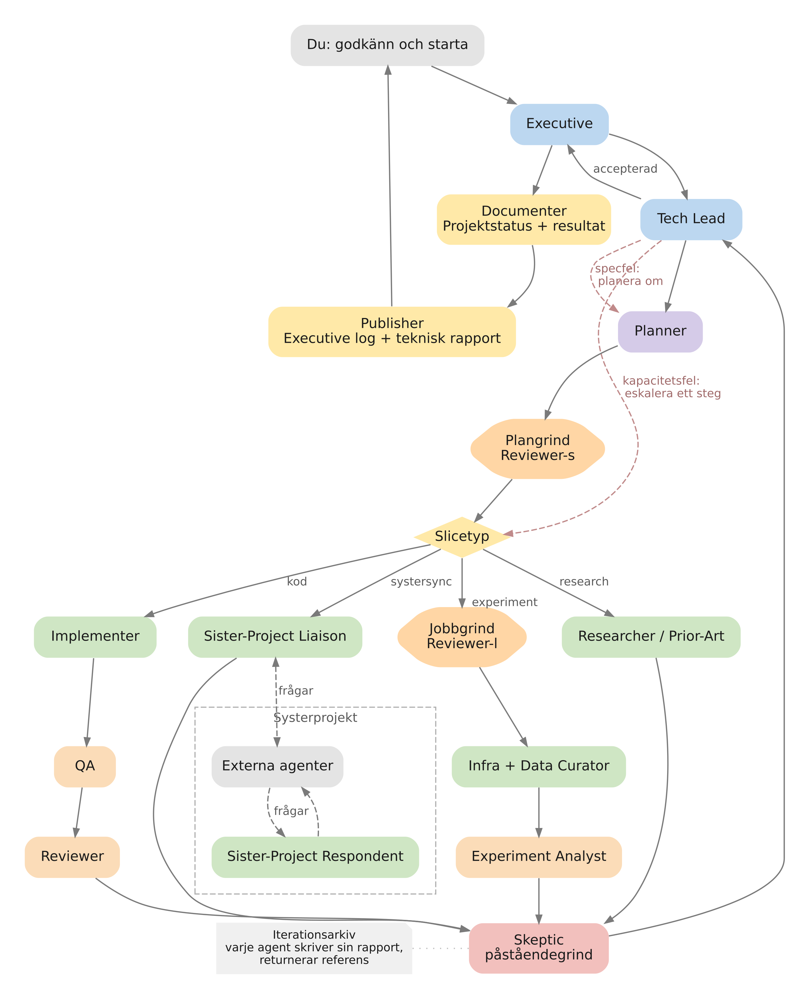

# DSpatch

Vision och styrdokument för agentisk programutveckling

Niclas Danielsson | 13 september 2026 | Version 1.8

Ändring i version 1.8: TypeScript, React och Electron är valt teknikspår. Windows och Linux ingår i målbilden med en enhetlig arbetsyta; första implementation och provkörning sker med Cursor på Windows. Motiven, gränserna och kvarstående verifiering beskrivs i avsnitt 9.1.

Ändring i version 1.7: Etapp 0 omfattar verkliga avgränsade kodändringar, vanlig fullständig textdiff och körning av relevant bygge eller test. Efter DSP-6 ska hela detta arbetsflöde vara provat med Niclas, inklusive avbrott, felåterhämtning och fortsatt arbete efter omstart.

Ändring i version 1.6: Cursor prioriteras för första integrationen och testningen på hemmadatorn. VS Code/Copilot kvarstår i målbilden; teknikvalen ska möjliggöra stödet, medan implementation och provkörning kommer senare. Leverantörsuppgifternas tidigare kontrolltidpunkt framgår i avsnitt 17.

## Målbild

DSpatch ska vara en utvecklingsmiljö där människan formulerar mål och väljer graden av egen medverkan. Arbetet kan drivas interaktivt eller genom autonoma agentloopar med rapportering på executive-nivå. Uppgifter, beslut, ändringar och verifiering hör ihop i samma arbetsyta. Koden kan alltid undersökas, kommenteras och redigeras för hand. Enkelhet i gränssnitt och arbetssätt är en ledstjärna, med bibehållen kraft och möjlighet att gå på djupet.

**Maestro är DSpatchs orkestrator.** Den ska samordna agentnätverk och iterativa arbetsflöden, följa beroenden, samla resultat och redovisa förbrukning. Copilot och Cursor är tänkta agentleverantörer. Hela projektet ska kunna drivas människointeraktivt så länge användaren vill, med valfri övergång till autonom iteration och tillbaka. Arbetssätt ska kunna utökas utan att hela produkten byggs om.

## Varför projektet behövs

När agenter utför mer av programmeringen förändras användarens arbete. Det blir viktigare att förstå vad som beställts, varför en lösning valts och om ändringen faktiskt fungerar. En lång chatt och en samling öppna filer ger inte alltid en tillräcklig överblick, särskilt när flera agenter arbetar samtidigt.

**DSpatch är både ett arbetsverktyg och en experimentmiljö för att utveckla själva utvecklingsarbetet.** Kodförståelse och granskning ska stödja tänkande och samarbete genom hela projektet. Användaren ska kunna följa avsikt, beteende och verifiering till verklig kod. Nytta ska uppstå från första användbara inkrementet, som kan vara en minimal interaktiv chattintegration.

## Vad vi vill kunna visa

Vid interaktivt arbete deltar användaren i resonemang, granskning och korrigering. Vid autonom körning sköter agentnätverket research, genomförande, granskning, verifiering och omtag inom givna ramar. Användaren får executive-rapporter, kan fördjupa sig och ingripa, och blir inkopplad när loopen behöver mänsklig styrning. Båda arbetssätten bevarar uppgifter, underlag och historik.

## Så används dokumentet

Avsnitt 1–3 beskriver målbild och användarupplevelse, inklusive lärande i 1.1, enkelhet i 2.1 och kodförståelse i 3.1. Avsnitt 4–8 behandlar Maestro, agentloopen och mänsklig styrning. Avsnitt 9–13 anger teknisk riktning. Avsnitt 14–15 ger inkrement och kriterier. Bakgrund och begrepp finns i 16, källor i 17.

Beslutsstatus: DSpatch är valt produktnamn och Maestro är orkestratorns arbetsnamn. Namnens tillgänglighet och varumärkesrättigheter är inte kontrollerade. Centralt är enkelhet, kodförståelse, lärande om arbetssätt och flexibel autonomi. Utvecklingen ska ge nytta stegvis från en minimal start. Agentloopen är ett exempel; arkitektur och etapper kan omprövas genom erfarenhet.

## 1 Identitet och beslut

### DSpatch och Maestro

DSpatch är det valda produktnamnet i projektet. DS står för Danielssons Studio. Namnet anspelar både på dispatch, att skicka ut uppdrag, och på patchar, kodändringarna som kommer tillbaka. Namnvalet är ett projektbeslut; det innebär inte att namnets tillgänglighet eller varumärkesrättigheter har kontrollerats.

**Maestro är tills vidare ett internt arbetsnamn för orkestratorn.** Musikassociationen beskriver hur självständiga bidrag samordnas till en helhet. Namnet används redan av en annan produkt för orkestrering av kodagenter, [Maestro från RunMaestro](https://runmaestro.ai/). Vilka rättigheter som finns och var de gäller har inte utretts. Arbetsnamnet kan användas under utvecklingen, men ett offentligt namn behöver bedömas separat före lansering. Komponenten kan också visas som ”orkestratorn” eller ”agentflöden” utan ett eget varumärke. Dokumentets användning av Maestro avser vår planerade komponent och innebär ingen koppling till den befintliga produkten.

| **Område** | **Status** | **Innebörd** |
| --- | --- | --- |
| Produktnamn | Valt | DSpatch är valt inom projektet. Tillgänglighet och rättigheter är inte kontrollerade. |
| Orkestrator | Arbetsnamn | Maestro används internt. Offentligt komponentnamn bedöms separat. |
| Arbetssätt | Målbild | Uppgiftscentrerat arbete med utbytbara loopar och valbar grad av autonomi. |
| Kodupplevelse | Målbild | Smart kodvisning och review, med möjlighet till enklare redigering. |
| Egen editor | Inriktning | Bygg en egen avgränsad kodvy och editor utan Monaco som grund. |
| Agentleverantörer | Målbild | Cursor och Copilot, med fortsatt stöd för arbete med VS Code. |
| Första integration och testning | Beslut 13 september 2026 | Cursor på Niclas hemmadator. VS Code/Copilot beaktas i teknikvalen men behöver inte implementeras eller provköras i Etapp 0. |
| Första milstolpen | Beslut 13 september 2026 | Interaktiv chatt, verklig kodändring, fullständig textdiff och bygge/test, med avbrott, sparad historik och manuell provkörning. |
| Teknikspår | Beslut 13 september 2026 | TypeScript, React och Electron för DSpatch. Motiven och verifieringen beskrivs i avsnitt 9.1. |
| Plattformar | Beslut 13 september 2026 | Windows och Linux i målbilden. Enhetlig arbetsyta eftersträvas; första implementation och provkörning sker på Windows. |
| Datalagring | Öppet | Lagringsmotor och format väljs i kommande inkrement. |

### Vem miljön byggs för

Den första användaren är en utvecklare som redan arbetar mycket med kodagenter, använder få avancerade redigeringsfunktioner och vill lägga sin tid på riktning, förståelse och kvalitet. En första version ska vara användbar i egna projekt och ge konkreta erfarenheter innan den breddas till fler användare eller arbetsmiljöer.

### Avgränsning

Projektet ska inte behöva nå full funktionsparitet med en etablerad IDE för att bli användbart. Avancerad manuell redigering, ett allmänt tilläggsekosystem, full debuggerintegration och generell fjärrutveckling ligger utanför den föreslagna första leveransen. Git, terminalkörning och pålitlig granskning har däremot direkt betydelse för kärnflödet.

### 1.1 Ett verktyg för arbete och lärande

**DSpatch ska vara både ett användbart verktyg och en experimentmiljö för att utveckla själva utvecklingsarbetet.** Projektet ska ge erfarenhet av hur vi vill och inte vill arbeta med agenter. Att bygga och använda verktyget är i sig ett sätt att lära, pröva idéer och förändra arbetssättet över tid.

#### Eget värde även när liknande verktyg finns

Projektets värde kräver inte att grundidén är unik. Liknande produkter ger jämförelser, inspiration och möjliga byggdelar. De kan göra konceptet mindre unikt utan att göra det mindre intressant att utveckla. Egna behov, glädjen i att bygga och möjligheten att undersöka nya arbetsformer är legitima skäl att fortsätta.

Den inledande omvärldsgenomgången belade främst orkestrering, arbetsytor och granskningsfunktioner. Den undersökte inte tillräckligt djupt hur väl verktygen hjälper användaren att bygga en mental modell av koden. Därför är bättre kodförståelse en ambition att pröva, inte en fastställd konkurrensfördel. Flera jämförda miljöer erbjuder mänsklig granskning; de ska inte generellt beskrivas som om de förutsätter att människan aldrig läser kod.

Exempel som belägger mänsklig granskning är [Intent](https://www.augmentcode.com/blog/intent-a-workspace-for-agent-orchestration) och [JetBrains Air](https://www.jetbrains.com/help/air/quick-start-with-air.html). Deras dokumenterade funktioner är jämförelseunderlag, inte resultat från ett praktiskt test i våra projekt.

#### Granskning som ett sätt att tänka och samarbeta

En diffvy visar vilka rader som förändrats. DSpatch ska dessutom hjälpa användaren att förstå beteende, sammanhang och skälen bakom ändringen. Granskning ska kunna pågå under formulering, undersökning och genomförande, så att en felaktig premiss kan upptäckas och diskuteras före nästa omtag. Den fyller därmed en större funktion än en slutkontroll.

#### Autonomi och begriplighet är separata val

**Autonomin bestämmer hur mycket arbete användaren delegerar. Begripligheten bestämmer hur väl användaren kan förstå och påverka resultatet.** DSpatch ska göra det möjligt att välja mycket av båda. Autonom körning ska bevara möjligheten till djup insyn, samtidigt som användaren kan stanna i ett nära samarbete under hela projektet.

#### Lärandet ska påverka nästa inkrement

Använd DSpatch i verkliga projekt och så tidigt som möjligt i dess egen utveckling. Notera var arbetet blir lättare, var överblick saknas och var verktyget skapar onödiga steg. Pröva en avgränsad förbättring, bedöm effekten och behåll, ändra eller ta bort den. Produktnytta och lärande om arbetssätt är båda resultat som ska vägleda fortsättningen.

## 2 Arbetsytan utgår från uppgiften

Användaren ska kunna öppna en uppgift och förstå vad som händer utan att först läsa en hel konversation. Uppgiften samlar avsikt, avgränsning, plan, agentkörningar, beslut, kodändringar och verifiering. Filträdet är tillgängligt som ett kompletterande sätt att hitta information.

### Exempel på ett interaktivt förlopp

Exemplet visar interaktivt arbete med en frysning vid zoom under uppspelning i ett ljudprogram. Användaren deltar i granskning och omtag. Samma uppgift visas i autonom form i avsnitt 2.2. Exemplet fastställer ingen verklig buggorsak.

- **Formulera:** Användaren beskriver felet, hur det reproduceras och vilket beteende som ska fungera efter ändringen.
- **Planera:** Maestro föreslår en undersökning, synliggör antaganden och delar vid behov upp arbetet i deluppgifter.
- **Arbeta:** Agenter analyserar berörda kodställen, genomför ändringar och rapporterar framsteg. Parallellt arbete får tydliga ansvarsområden.
- **Granska:** Användaren ser diffar tillsammans med motiv och relevant omgivande kod. En oberoende agent kan granska samma bestämda revision.
- **Verifiera:** Bygg- och testresultat kopplas till den ändring som faktiskt kördes. Osäkra eller oprövade scenarier framgår.
- **Korrigera:** En kommentar som ”detta måste också fungera under playback” blir ett avgränsat omtag. Användaren kan också rätta några rader själv.
- **Avsluta:** Uppgiften får ett tydligt resultat, en granskningsstatus och samlad rapporterad förbrukning. Tidigare försök finns kvar.

### Föreslagen disposition i gränssnittet

Projektöversikten visar aktiva uppgifter, blockerade beroenden och sådant som väntar på användaren. Uppgiftsvyn visar sammanfattning och beslut överst, följt av plan och deluppgifter. Kod och diffar öppnas intill det resonemang de hör till. Agentdialog och rålogg finns nära till hands, men behöver inte dominera hela arbetsytan.

Användaren ska kunna växla mellan helhetsbild och detalj utan att tappa sin plats. Ett klick på ett testfel ska kunna leda till loggen och den granskade revisionen; ett klick på en ändringsförklaring ska kunna leda till den exakta diffen.

### Mänsklig styrning

Maestro ska kunna föreslå nästa steg och utföra arbete inom givna ramar. Användaren ska kunna ändra prioritet, precisera ett mål, avbryta en körning eller begära en ny granskning. Hur mycket som körs automatiskt ska kunna väljas per projekt eller uppgift.

### 2.1 Enkelhet med bibehållen kraft

**Enkelhet ska prägla både gränssnittet och arbetssättet.** DSpatch ska göra avancerat agentarbete tillgängligt genom begripliga handlingar, rimliga standardval och tydlig återkoppling. Användaren ska kunna börja med sitt projekt och successivt fördjupa kontrollen. Enkelhet får inte dölja relevanta ändringar, osäkerheter eller konsekvenser.

#### Vanliga handlingar ska gå att hitta

Öppna projekt, köra kod eller tester, starta och stoppa agenter, granska ändringar och växla arbetssätt ska ha synliga, konsekventa vägar i gränssnittet. Kortkommandon och kommandopalett får ge snabbare åtkomst men ska vara valfria. Samtal med en agent ska komplettera dessa handlingar; användaren ska inte behöva gissa rätt formulering för att nå en grundfunktion.

#### Konfiguration ska få ett begripligt gränssnitt

För stödda projekttyper ska DSpatch känna igen hur projektet byggs och körs, eller hjälpa användaren att välja det som saknas. Körkommandot och arbetskatalogen ska gå att se, ändra och spara i gränssnittet. Vanliga uppgifter ska inte kräva handredigering av konfigurationsfiler. Konfiguration som text ska kunna finnas för avancerad användning och versionshantering, med samma värden som gränssnittet visar.

#### Inställningar ska ge synlig effekt

Visa vilket värde som faktiskt gäller, om det kommer från projektet eller användarens standardval och när en ändring börjar gälla. Om en regel eller en leverantör begränsar valet ska det framgå där valet görs. Misslyckat sparande eller tillämpning ska ge ett begripligt fel och ett nästa steg. Undvik inställningar som ser ändrade ut men saknar effekt.

#### Återhämtning ska vara en del av produkten

Återanslut automatiskt när det är säkert. När användaren behöver ingripa ska den berörda vyn förklara problemet och erbjuda exempelvis Försök igen eller Återanslut. Normal användning ska inte bero på dolda utvecklarkommandon som Developer: Reload Window. Om en komponent måste startas om ska DSpatch erbjuda den åtgärden och bevara arbetet.

#### Fördjupning på användarens villkor

Visa de val som behövs i det aktuella sammanhanget och låt användaren öppna fler detaljer därifrån. Avancerade arbetsflöden, modeller, verktyg och mätvärden ska fortfarande vara åtkomliga. Samma begrepp och projektkontext ska följa med mellan översikt, detaljarbete och autonom iteration. Nya funktioner ska passa in i detta arbetssätt.

#### Visuell kvalitet och responsivitet

Arbetsytan ska kännas modern, sammanhållen och genomarbetad redan i de första användbara inkrementen. Typografi, ikoner, färger, avstånd och kontroller ska vara konsekventa. Windows och Linux ska erbjuda samma centrala layout och arbetsflöden. Anpassning till fönsterstorlek och skärmskalning ska bevara läsbarhet och åtkomst till vanliga handlingar.

Strömmande agentsvar och pågående arbete ska låta användaren fortsätta skriva, scrolla, byta vy och avbryta utan störande hack eller tappat fokus. Teknikvalet är inget bevis för uppnådd kvalitet. Niclas provkörning och mätningar med representativa konversationer och diffar ska styra förbättringarna; Windows provas först och Linux när stödet införs.

#### Föreslaget användbarhetsprov

Låt en utvecklare som inte känner DSpatch öppna ett stött projekt, köra kod och tester, ge en agent en uppgift, granska resultatet och växla mellan interaktivt arbete och loopen. Prova också en ändrad inställning och en tappad anslutning. Förloppet ska gå att genomföra utan memorerade kortkommandon, handredigerad konfiguration eller dolda återställningskommandon. Notera var användaren måste fråga, leta eller gissa; använd det som underlag för förbättring.

### 2.2 Exempel på autonomt agentarbete

**I det autonoma arbetssättet ligger det löpande arbetet hos agenterna.** Användaren styr på executive-nivå och kan följa resultat utan att själv delta i varje research-, gransknings- eller korrigeringssteg. Samma zoomproblem som i det interaktiva exemplet kan hanteras så här.

#### Från högnivåmål till en eller flera iterationer

- **Ange mål och starta:** Användaren beskriver önskat beteende, exempelvis stabil zoom under uppspelning, samt kvalitetskrav och resursramar. Via Executive-agenten startar användaren en eller flera iterationer. Mandatet anger när fortsatt körning är tillåten.
- **Välj nästa iterationsmål:** Executive-agenten utgår från högnivåmålet, tidigare resultat och kvarvarande osäkerheter. Den väljer nästa steg, exempelvis reproduktion och orsaksanalys, och delegerar till nätverket.
- **Undersök och genomför:** Tech Lead och Planner samordnar arbetet. Research- och implementationsagenter samlar underlag, prövar hypoteser och genomför ändringar. Planen uppdateras när ny kunskap kräver det.
- **Granska och iterera:** Gransknings- och QA-agenter bedömer ändringen, kör relevanta tester och prövar påståenden mot underlaget. Fel eller otillräckliga resultat leder till omplanering, korrigering eller eskalering inom nätverket. Mänsklig kodgranskning är möjlig men inget obligatoriskt steg i detta läge.
- **Rapportera och fortsätt eller stanna:** Executive-agenten sammanställer iterationens resultat och väljer nästa iterationsmål inom mandatet. Loopen fortsätter över flera iterationer om det är tillåtet. Den stannar när målet är uppnått, en gräns nås eller mänsklig input behövs.

#### När människan behöver kopplas in

Användaren kan ingripa om rapporteringen tyder på ett allvarligare problem eller ändra riktning när som helst. Loopen ska själv stanna och be om styrning när den inte kan reda ut ett problem inom sitt mandat, exempelvis efter upprepade resultatlösa omtag eller vid en avgörande målkonflikt. Rapporten ska ange vad som prövats, vad som blockerar och vilket beslut som behövs.

#### Samma projekt kan återgå till interaktivt arbete

Rapporter, tester, ändringar och beslut följer med till fortsatt dialog och detaljarbete. Användaren kan stanna där så länge det behövs och senare återstarta loopen från det uppdaterade läget. Ett avslutat agentsteg ska ha ett synligt resultat och verifieringsunderlag även när ingen människa granskat det manuellt.

## 3 Kodgranskning och enkel redigering

Kodupplevelsen ska hjälpa användaren att bygga en mental modell av koden och förändringen. Relevanta funktioner från flera filer ska kunna visas tillsammans, med möjlighet att öppna hela filen och följa referenser när språkstödet medger det. Granskning ska stödja tänkande och samarbete genom hela arbetet. Avsnitt 3.1 konkretiserar denna centrala ambition.

### Granskning med full insyn

- Visa före och efter, med omgivande rader och möjlighet att växla mellan sammanhållen diff och vy sida vid sida.
- Låt användaren se alla ändrade filer och fullständig diff, även när agenten föreslagit ett urval eller en tematisk gruppering.
- Fäst kommentarer vid fil, kodställe och revision. Bevara diskussionen när agenten gör ett nytt försök.
- Skilj mellan agentens påstående, granskarens bedömning och ett faktiskt testresultat.
- Gör ändrade, tillagda och borttagna filer synliga. Gruppering ska inte kunna dölja återstående ändringar.
- Ge stöd för att begära en korrigering direkt från den kod användaren läser.

### Granskningen gäller en bestämd version

En review ska avse en identifierad version av ändringarna. Om agenten fortsätter arbeta ska den pågående granskningen ligga kvar på sin version och visa att nyare ändringar finns. Ett tidigare godkännande ska inte automatiskt gälla kod som tillkommit senare.

Att godkänna enskilda delar kan bli värdefullt, men beroenden mellan ändringarna måste synliggöras. I en tidig version är det rimligt att granska hela ändringsmängden och begära riktade omtag innan selektiv sammanföring införs.

### Den egna editorns första omfattning när den införs

Förslaget är en egen textmodell och kodvy ovanpå en befintlig GUI-plattform. Kärnan omfattar läsbar monospaced text, radnummer, syntaxfärgning, scrollning, markör, markering, sökning, urklipp, öppna och spara samt undo och redo. Grundläggande indrag och tydlig status för osparade ändringar behövs för bekväma korrigeringar.

Flera markörer, avancerade refaktoreringar och ett stort antal redigeringskommandon kan vänta. Textmodellen måste ändå hantera Unicode, olika radslut och förändringar utan att skada filen. Återanvändbara bibliotek för exempelvis syntaxanalys kan användas även om själva editorn är egen.

### Manuella ändringar under agentarbete

Om en användare har osparad text och en agent ändrar filen ska DSpatch upptäcka konflikten. Användarens arbete får inte skrivas över tyst. Val mellan spara, jämföra och förena versioner ska utgå från faktiska filversioner, inte enbart från vad chatten uppger.

### 3.1 Förstå förändringar och deras sammanhang

**Att ha en diffvy är inte samma sak som att förstå en förändring.** DSpatch ska hjälpa användaren att koppla ändrade rader till beteende, samband, beslut och evidens. Följande är riktningar att utveckla och utvärdera stegvis, inte ett krav på att allt finns i första versionen.

| **Frågan användaren vill besvara** | **Vad arbetsytan skulle kunna visa** |
| --- | --- |
| Vad har egentligen ändrats i beteendet? | Gruppera ändringar efter avsikt, exempelvis ”samlar zoomhändelser” och ”ändrar cachehantering”, även när de ligger i olika filer. |
| Hur hänger detta ihop? | Visa berörda anropskedjor, dataflöden och relevant oförändrad kod tillsammans med ändringarna. |
| Varför gjorde agenten så? | Knyt ändringen till mål, antaganden, övervägda alternativ och beslut. |
| Vad vet vi faktiskt fungerar? | Koppla testresultat och experiment till den exakta revisionen och visa vad de inte täcker. |
| Vad behöver jag förstå först? | Ge en översikt som går att fördjupa från beteende och arkitektur ner till enskilda rader. |
| Vad hände sedan jag tittade senast? | Visa förändringar sedan användarens senaste granskning och vilka tidigare slutsatser som behöver omprövas. |

#### Exempel med zoom under uppspelning

I ljudprogrammets zoomexempel skulle arbetsytan kunna hjälpa användaren att följa **hjulhändelse → viewport → cacheuppdatering → rendering**, med playback som ett parallellt förlopp. Visa relevanta ändringar och oförändrade kodställen längs vägen. Då kan användaren upptäcka en felaktig premiss och diskutera den med agenterna innan deras nästa omtag. Förloppet illustrerar en möjlig vy och fastställer ingen verklig buggorsak.

#### Förklaringen måste gå att kontrollera

En övertygande agentberättelse får inte ersätta insyn i den verkliga koden. Varje föreslagen ändringsgrupp och beskrivet samband ska kunna följas till underlaget. Visa vad som kommer från kodanalys, körda tester respektive agentens tolkning, och markera osäkra samband. Fullständig diff och återstående ändringar ska alltid vara åtkomliga.

#### Prova om förståelsen faktiskt förbättras

Låt användaren förklara ändringens beteende, peka ut ett relevant beroende och identifiera en osäkerhet med hjälp av vyn. Jämför med vanlig diffgranskning av liknande uppgifter. Bedöm begriplighet, felupptäckt och hur lätt det är att fortsätta resonemanget med agenten; färre öppnade kodfiler är inget mål i sig.

## 4 Maestro och agentnätverket

Den tekniska fördjupningen [Maestro och orkestrering av agentloopar](MAESTRO_ORCHESTRATION.md) beskriver egen orkestrering över oberoende agentsessioner, logiska deluppgifter, återhämtning och kostnadsbokföring per loopsteg. Den konkretiserar riktningen i detta avsnitt utan att utöka Etapp 0.

Maestro ska samordna arbetet över flera körningar och leverantörer. Det primära exemplet är en iterativ agentloop med specialiserade roller, granskningsgrindar och återkoppling. Maestro ska även kunna bära andra upplägg. Applikationen håller reda på uppgifter, tillstånd, budget och arbetskopior; agenternas text är inte ensam bärare av projektets tillstånd.

### Föreslagna ansvarsområden

| **Ansvar** | **Vad Maestro ska hålla reda på** |
| --- | --- |
| Planering | Mål, deluppgifter, beroenden och kriterier för att vara klar. |
| Fördelning | Vilken agent och leverantör som arbetar med vilken uppgift. |
| Samordning | Parallellitet, väntande resultat och arbete som riskerar att kollidera. |
| Genomförande | Start, avbrott, återupptagning, fel och nya försök. |
| Granskning | Vilken revision som granskats, av vem och med vilket resultat. |
| Ekonomi | Förbrukning per körning och uppgift samt gränser för fortsatt arbete. |

### Roller och delegering

Planering, implementation och granskning är grundfunktioner. Referensloopen i avsnitt 5–6 visar en mer utvecklad rollfördelning. Roller anger ansvar och instruktioner, inte en fast modell eller en permanent hierarki i Maestro. En separat granskare ska kunna pröva mål och underlag utan att okritiskt ta över utförarens slutsatser.

En agent ska kunna begära en deluppgift genom Maestro. Orkestratorn beslutar om den får starta och väljer leverantör enligt projektets inställningar. Detta möjliggör delegering över flera nivåer utan att hela projektet är beroende av en viss leverantörs interna subagentsystem. Leverantörernas egna subagenter kan användas där de passar.

Förslaget är att sätta gränser för samtidiga körningar, delegeringsdjup och antal omtag. En deluppgift behöver ett avgränsat mål och ett resultat som går att återföra till föräldrauppgiften. Maestros egen planering och samordning kan också förbruka modellresurser och ska då räknas in.

### Isolering och sammanföring

Parallella skrivande agenter bör normalt arbeta i separata Git-arbetskopior. Varje resultat förankras i en känd basrevision. Maestro samordnar när ändringar förs ihop, upptäcker konflikter och beställer verifiering av det sammanförda resultatet. Två godkända delresultat innebär inte automatiskt att kombinationen fungerar.

En uppgift kan vara planerad, redo, pågående, blockerad, redo för granskning, under verifiering, klar, misslyckad eller avbruten. Tillstånden är ett förslag. Skillnaden mellan ”agenten svarade” och ”uppgiften är verifierad och klar” ska däremot alltid vara synlig.

### 4.1 Tre nivåer och en gemensam målbild

**Referensupplägget har tre nivåer med olika ansvar.** De beskriver hur användaren samverkar med Executive-agenten och agentnätverket. Maestro ska stödja detta upplägg och samtidigt kunna bära andra arbetsflöden enligt avsnitt 7.

#### Nivå 1 Användarens dagliga loop

Användaren läser en executive summary, tar ställning till riktning och godkänner samt startar en eller flera iterationer via Executive-agenten. Rapporteringen kan vara en integrerad del av DSpatch eller visas via en valfri adapter till en dashboard, Confluence eller ett annat system. Vid problem kan användaren öppna en djupare Tech Lead-rapport med underlag och beslutspunkter.

Ett godkännande kan omfatta flera iterationer. Återkommande mänskligt godkännande av varje intern plan, researchinsats eller kodändring ska inte vara ett krav i autonomt läge. Användaren behåller möjlighet att gripa in, pausa eller återgå till interaktivt projektarbete.

#### Nivå 2 Executive-agenten

Executive-agenten äger arbetet mot det högnivåmål som användaren definierat. Den väljer nästa iterationsmål, delegerar genom nätverket, samlar rapporter och ansvarar för att en executive-rapport och en fördjupad Tech Lead-rapport produceras i slutet av iterationen. Underagenter kan skriva underlaget och sköta sammanställningen.

Executive-agenten kan ändra delmål och plan inom mandatet, men ska begära mänsklig styrning när högnivåmålet eller ramarna behöver omprövas. Maestro tillhandahåller körning, tillstånd, verktygsanslutningar och historik; Executive är en agentroll i arbetsflödet.

#### Nivå 3 Agentnätverket

Specialiserade roller som Tech Lead, Planner, Implementer, Reviewer och Researcher samverkar, rapporterar till varandra och uppdaterar planen. Andra roller kan ansvara för projektöversikt, dokumentation och rapportering, oberoende av presentationsverktyg. Research, oberoende granskning, testning och korrigering sker inom nätverket. Lokala problem återförs i loopen; problem som nätverket inte kan lösa förs till Executive och vid behov till användaren.

#### Domänen anger vad projektet ska åstadkomma

Domänen beskriver målbild, begrepp och kvalitetskriterier, exempelvis ett AI-träningsramverk, ett strategispel eller en musikstudio. Den är ingen ytterligare chefsnivå. Samma grundupplägg ska kunna användas med olika domäner, medan roller, verktyg, utvärdering och rapportinnehåll anpassas till projektet.

#### Rapportering som gör autonomin begriplig

Executive-rapporten ska kort visa måluppfyllelse, viktiga resultat, förbrukning, problem och nästa steg. Tech Lead-rapporten ska göra det möjligt att följa tekniska slutsatser till tester, mätningar, ändringar och kvarvarande osäkerheter. När loopen stannar ska status skilja mellan uppnått mål, resursgräns och behov av mänskligt beslut. Samma underlag ska kunna presenteras internt eller via valfria adaptrar; kanalbyte ska bevara historiken och inget externt presentationssystem ska krävas för att loopen fungerar.

## 5 Referensloop för agentarbete

Figur 1. Exempel på möjlig loop-struktur.

## 6 Roller och återkoppling i referensloopen

Loopen beskriver hur en godkänd uppgift planeras, delas upp efter arbetstyp och återkommer för bedömning. Deluppgiften kallas slice i bilden. Beskrivningen följer den generaliserade figurens roller och kopplingar; experimentgrenen kan exempelvis användas för träning och utvärdering av en modell. [11]

### Ledning och planering

Användaren godkänner och startar en eller flera iterationer. Executive väljer nästa iterationsmål och lämnar vidare till Tech Lead, som kopplar in Planner. Planen passerar agentgrinden Reviewer-s före val av slicetyp. Reviewer-s och Reviewer-l är bildens beteckningar, utan fasta modeller eller kapacitetsnivåer. Den övergripande ansvarsfördelningen beskrivs i avsnitt 4.1.

| **Arbetstyp** | **Väg i bilden** | **Resultat som förs vidare** |
| --- | --- | --- |
| Research | Researcher / Prior-Art till Skeptic. | Forskningsunderlag och påståenden att pröva. |
| Kod | Implementer till QA och Reviewer, sedan Skeptic. | Kodändringar och deras kvalitetsbedömning. |
| Experiment | Jobbgrind Reviewer-l till Infra + Data Curator, sedan Experiment Analyst och Skeptic. | Ett genomfört jobb med experimentanalys. |
| Systersynk | Sister-Project Liaison utbyter frågor med systerprojektet och återför till Skeptic. | Kunskap eller svar från ett närliggande projekt. |

### Återkoppling har olika orsaker

Skeptic fungerar som en påståendegrind och återför till Tech Lead. Bilden skiljer mellan **specifikationsfel**, som leder tillbaka till Planner för omplanering, och **kapacitetsfel**, som leder till eskalering ett steg och ny behandling av aktuell slicetyp. Accepterat resultat går från Tech Lead till Executive. Exakt hur eskalering väljer modell, resurser eller arbetssätt behöver definieras i den körbara versionen.

### Rapporter och kunskapsutbyte

Executive kopplar in Documenter för projektstatus och resultat. Publisher sammanställer executive log och teknisk rapport till användaren. Varje agent skriver sin rapport i ett gemensamt iterationsarkiv och returnerar en referens. DSpatch ska kunna koppla rapporterna till rätt iteration och visa dem utan att allt kopieras i chatten. Filnamn, lagringsplats och presentationskanal väljs för projektet.

Systerprojektet är en generell extern samarbetspart. Bilden visar externa agenter och en Sister-Project Respondent med ett eget frågeutbyte. Maestro behöver kunna representera kontakten och dess vänteläge utan att ta över systerprojektets interna orkestrering. Rapporter kan visas direkt i DSpatch eller förmedlas genom valfria adaptrar inom projektets mandat.

## 7 Utbytbara arbetssätt i Maestro

**Flexibilitet är en del av målbilden.** Referensloopen ligger närmast det primära arbetssättet. Kommittéer som diskuterar och röstar, såsom det MAD-upplägg användaren beskriver, ska samtidigt vara möjliga. Framtida koncept ska kunna införas genom avgränsade tillägg i stället för att hela produktidén byggs om.

### Skilj arbetsflöde från körmiljö

Ett arbetsflöde beskriver roller, överlämningar, grindar och återkoppling. En körmiljö beskriver var och hur stegen utförs. Samma rollfördelning ska kunna prövas med olika leverantörer, modeller och lokala eller externa körmiljöer när integrationerna stöder det. Roller som Executive och Tech Lead tillhör referensflödet; de ska inte vara obligatoriska nivåer i Maestro.

### Föreslagen utbyggbar modell

- **Versionssatta arbetsflöden:** definiera steg, ansvar, in- och utdata, beroenden, villkor och återkoppling. Loopen kräver cykler; enbart en graf utan återkoppling räcker inte.
- **Utbytbara beslutssätt:** ett steg kan använda regler, en agent, en människa eller en kommitté. Röstning och sammanvägning ska kunna läggas till med egen redovisning av underlaget.
- **Tydliga gränssnitt:** körning, resultat, händelser, fel och förbrukning har gemensamma kontrakt. Nya stegtyper kan komplettera dem med specifika data.
- **Gemensam historik:** uppgifter, iterationer, underlag och beslut behåller sin identitet även när modellen, rollen eller arbetssättet ändras.
- **Utbyggbar presentation:** nya steg får en begriplig grundvy för status, indata och resultat. Specialvyer kan läggas till utan att projekt- och granskningsvyerna måste ersättas.

### Flexibilitet som går att verifiera

Ett föreslaget acceptansprov är att först köra referensloopen och sedan lägga till ett enklare kommittéflöde via dess tilläggsgränssnitt. Uppgiftshistorik, kostnadsredovisning och kodgranskning ska fungera för båda utan ändringar i sina grundläggande datamodeller. En ny körmiljö ska kunna införas oberoende av arbetsflödesdefinitionen.

Ingen arkitektur kan förutse alla framtida idéer. Målet är därför versionshanterade kontrakt, tydliga tilläggspunkter och kontrollerade migreringar. Första versionen behöver inte innehålla en allmän visuell flödesbyggare; en strukturerad definition är tillräcklig om den verkligen går att byta ut.

## 8 Mänsklig styrning och autonom iteration

**Det människointeraktiva läget är ett fullvärdigt arbetssätt för hela projektet.** Användaren ska kunna stanna där så länge som behövs eller önskas, även genom hela projektet. Övergång till agentloopen är valfri och sker när eller om målbilden och projektets mognad gör det lämpligt. Det ska vara lika naturligt att växla tillbaka.

| **Arbetssätt** | **Användarens roll** | **Maestros beteende** |
| --- | --- | --- |
| Människointeraktivt arbete | Driver resonemang, detaljiteration och beslut över hela projektet. | Bevarar kontext och historik, ger agentstöd och utför överenskommet arbete. |
| Styrning vid grindar | Anger riktning och tar ställning vid valda beslutspunkter. | Driver rutinmässiga steg och stannar vid konfigurerade grindar eller avvikelser. |
| Autonom iteration | Anger högnivåmål och mandat, läser executive-rapporter och ingriper vid behov. | Driver agentloopen inklusive granskning och omtag; rapporterar och stannar vid behov av mänsklig styrning. |

### Kontinuitet mellan arbetssätten

Interaktivt arbete kan omfatta teori, planering, experiment, kodning och granskning över många sessioner. Användaren ska kunna diskutera och detaljiterera tillsammans med agenter utan att aktivera en autonom loop. Samma projekt, uppgifter, underlag och beslut följer med när arbetssättet ändras. Olika delar av projektet kan också ha olika grad av autonomi.

Vid övergång till loopen väljs aktuell målversion, startpunkt och mandat. Vid återgång till interaktivt arbete bevaras vad loopen har gjort och vilka frågor som återstår. Växlingen sker vid definierade säkra punkter; pågående verktyg kan behöva avslutas separat. Nya mål eller ändringar ska markera tidigare verifiering som inaktuell där den berörs.

### Mål och metriker som grund för iteration

För autonom körning bör uppgiften ange önskat resultat, startläge, vad som får ändras, hur resultatet mäts och när loopen ska stanna. Kriterierna kan vara kvalitativa eller mätbara. Exempel är godkända tester eller förbättrad ReID-prestanda under givna gränser för latens och minne; inga numeriska mål är fastställda här.

Mätprotokoll, data och målversion ska följa varje iteration så att jämförelsen är meningsfull. Utebliven förbättring, motstridiga resultat, oklar specifikation eller en resursgräns kan utlösa stopp eller mänsklig bedömning. En förbättrad metriksiffra ska inte ensam räcka om övriga kvalitetskrav försämras.

### Föreslaget acceptansprov

Driv projektet interaktivt över flera sessioner. Kör sedan flera autonoma iterationer med research, granskning, verifiering och omtag inom nätverket, utan rutinmässiga mänskliga delgodkännanden. Kontrollera executive-rapporter och ett stopp som begär mänsklig styrning. Återgå till interaktivt arbete med uppgifter, målversioner, underlag, kommentarer och kostnader bevarade, utan att starta om slutfört arbete.

## 9 Arkitektur och projektets data

Arkitekturen är en riktning att växa mot. Första inkrementet behöver bara en tunn gräns mellan chattgränssnitt, leverantörsadapter och projektets sparade tillstånd. Därefter skiljs arbetsflöden och körmiljöer åt när behoven blir konkreta. Maestro ska kunna tillföra loopar och andra agentupplägg utan att gränssnittet binds till en leverantör eller en bestämd topologi.

| **Del** | **Föreslagen funktion** |
| --- | --- |
| DSpatch | Projekt- och uppgiftsvyer, kodläsning, diffar, kommentarer och lätt redigering. |
| Maestro | Körning av utbytbara arbetsflöden, delegering, beroenden, budget och mänsklig styrning. |
| Leverantörsadaptrar | Starta och följa Copilot- eller Cursor-körningar samt tolka deras händelser. |
| Arbetsmiljö | Git, filer, terminalprocesser, byggkommandon och testkörningar. |
| Beständig lagring | Uppgifter, körningar, revisioner, beslut, förbrukning och granskningshistorik. |

### 9.1 Valt teknikspår och plattformar

**Beslut 13 september 2026: bygg DSpatch med TypeScript, React och Electron, med Windows och Linux i målbilden.** Första implementation och provkörning sker med Cursor på Niclas Windowsdator. Linuxstödet införs och verifieras stegvis; en fungerande Linuxversion är inte ett krav för Etapp 0.

TypeScript är huvudspråk för gränssnitt, projektlogik och leverantörsadaptrar. React med HTML/CSS används för den egna arbetsytan. Electron ger desktopfönster och lokal systemintegration; Node.js används för agentintegrationerna. Valet styr inte språken i de projekt som DSpatch arbetar med.

En enhetlig upplevelse på Windows och Linux är ett centralt motiv. Electron låter oss distribuera samma Chromium-version på båda plattformarna. Gemensamma typsnitt, ikoner och styling ska stödja en konsekvent arbetsyta. Skärmskalning, textåtergivning, fönsterhantering och systemdialoger behöver ändå provas på respektive system. Node/TypeScript passar också de dokumenterade SDK-vägarna för Cursor och Copilot, vars faktiska funktion måste verifieras. [2][3][12]

Tauri övervägdes som alternativ med mindre grundpaket genom systemets webview. Electron valdes främst för kontrollen över renderingsmiljön mellan Windows och Linux. Nackdelen är ett större grundpaket med egen Chromium- och Node-miljö. Ingen prestanda- eller minnesjämförelse har genomförts för DSpatch; antalet tekniker är inte det avgörande motivet. [12][14]

Håll gränssnitt och projektdata fria från direkta leverantörsanrop och plattformsspecifika detaljer. Låt agentkörningar, Git-operationer, byggen och tunga diffberäkningar ske asynkront utanför gränssnittstråden, i bakgrundsprocesser där det behövs. Stora konversationer och diffar ska visas utan att hela innehållet behöver renderas om vid varje uppdatering. [13]

DSP-1 verifierar teknikspåret och den valda Cursor-anslutningen, inklusive ett minimalt paketerat Windowsprov. Exakta beroendeversioner, lagring och senare Linuxpaketering återstår att konkretisera. Teknikspåret kan omprövas vid dokumenterade hinder; bevara projektdata, leverantörsgränser och målbild vid ett sådant byte.

### Gemensamt integrationskontrakt

Varje leverantörs- och körmiljöadapter bör redovisa sitt stöd för start, strömmande svar, avbrott, återupptagning, modellval, godkännanden och kostnadsrapportering. Arbetsflödet väljer lämplig adapter per steg. Saknat stöd ska framgå, och en gemensam vy får inte antyda att leverantörerna fungerar identiskt.

Leverantörens råhändelser bör kunna sparas tillsammans med en normaliserad representation. Då går det att felsöka integrationen, förbättra tolkningen och förklara varifrån en status eller kostnad kommer. Normaliserade händelser får stabila identifierare så att återanslutning inte duplicerar tidigare resultat.

### Föreslagna informationsobjekt

Projektet innehåller uppgifter med mål, avgränsning och acceptanskriterier. En uppgift kan ha en förälder och flera körningar. Körningen anger leverantör, session, modell, arbetskopia, tidsstämplar och avslutningsorsak. Ändringar och verifieringar refererar till den revision som producerades eller testades.

Kommentarer och granskningsbeslut behöver både en koppling till uppgiften och en stabil kodreferens. Förbrukningsposter behöver leverantör, enhet, omfattning och källhändelse. Exakta fältnamn och lagringsformat fastställs i en senare teknisk specifikation.

### Beständighet och framtida anslutningar

Lokal databas eller strukturerade filer är båda möjliga. Valet ska stödja återställning, export och spårbarhet. Leverantörens chatthistorik är värdefull kontext, men ersätter inte projektets egen bokföring av uppgifter och beslut. Externa projektsystem kan anslutas senare utan att behöva bli ett villkor för att DSpatch fungerar.

## 10 Copilot och Cursor som agentleverantörer

### Copilot

GitHubs Copilot SDK ger programmatisk åtkomst till motorn bakom Copilot CLI. Eget gränssnitt och kopplingen till editorn byggs i DSpatch. SDK:t är inte en färdig kopia av VS Codes chattpanel och innebär inte automatisk funktionsparitet med VS Code. Det finns bland annat för TypeScript, Python och .NET. [1]

Dokumenterat stöd omfattar sessioner, strömmande svar, modellval, egna verktyg och MCP. GitHub-inloggning kan användas för Copilot-åtkomst; alternativet med egna modellnycklar har ett annat åtkomst- och debiteringsupplägg. Standardanvändning av SDK:t följer CLI:s användningsmodell. Vilka modeller som erbjuds ska läsas från den aktuella miljön. [1–2]

### Cursor

Cursor har ett TypeScript-SDK för lokala agentkörningar och molnkörningar. Lokal körning avser agentloop och filåtkomst; modellen anropas fortfarande som en tjänst. SDK:t ger stöd för att starta, följa, avbryta och återuppta arbete. Enligt dokumentationen belastar användarnycklar användarens plan, med samma prissättning och förbrukningspotter som motsvarande produktkörningar. [3]

Cursor CLI stöder dessutom ACP, Agent Client Protocol, för egna klienter och editorer. Kommunikation sker med JSON-RPC över standard in och ut. Protokollet omfattar sessioner, uppdateringar, godkännanden och avbrott. Headless CLI med JSON eller strömmande JSON är ytterligare en integrationsväg. [4–5]

### Föreslagen användning i DSpatch

Första inkrementet är en minimal interaktiv chatt med Cursor som första agentleverantör, eftersom Niclas redan arbetar med Cursor hemma. Välj anslutningsväg i teknikprovet och verifiera den med hans faktiska konto och hemmadator. Filändring, en vanlig fullständig textdiff och körning av relevant bygge eller test ingår redan i Etapp 0. Förbrukningsmätning byggs vidare när tillförlitliga värden finns och motsvarande funktion prioriteras.

VS Code och Copilot ska fortsatt stödjas i målbilden. Håll leverantörsspecifika anrop och sessionsdata bakom en tunn adapter och undvik att gemensam gränssnittslogik, projektdata eller bygginstruktioner kräver Cursors interna tillstånd. Teknikvalen ska bedömas med framtida VS Code/Copilot-stöd i åtanke, men den integrationen behöver inte implementeras eller provköras i Etapp 0. Dokumentera antaganden, kända hinder och återstående kompatibilitetsprov; förenlig arkitektur är inte detsamma som verifierad funktion.

| **Förmåga att kontrollera** | **Vad prototypen ska visa** |
| --- | --- |
| Åtkomst | Inloggning, tillgängliga modeller och fungerande lokal arbetskopia. |
| Livscykel | Start, uppdateringar, avbrott och fortsatt arbete efter omstart. |
| Verktyg | Filändring och terminalkörning med begriplig felrapportering. |
| Förbrukning | Rapporterade mått, enheter, fördröjning och hur de avgränsas. |
| Gränssnitt | Händelser kan kopplas till rätt uppgift och visas utan duplicering. |

**Kunskapsläge:** Integrationsmöjligheterna är belagda i leverantörernas dokumentation. Någon fungerande DSpatch-integration eller mätning mot användarens konton är ännu inte genomförd. Leverantörsversioner och ändrade villkor behöver följas under projektet.

## 11 Verktyg MCP och REST

DSpatch behöver kunna ge agenter tillgång till projektets verktyg och externa API:er. Diskussionen skiljde mellan MCP-servrar, egna SDK-verktyg och vanliga skript. Alla tre kan fylla en funktion; en integration behöver inte göras till en MCP-server enbart för att en agent ska kunna använda den.

| **Väg** | **Hur den fungerar** | **När den är lämplig** |
| --- | --- | --- |
| MCP-server | Klienten hämtar verktygsbeskrivningar och anropar serverns verktyg. | När standardiserad anslutning och återanvändning mellan klienter är värdefull. |
| Eget SDK-verktyg | SDK:t anropar en funktion i värdapplikationen och återför resultatet. | När DSpatch äger integrationen och behöver en strukturerad funktion. |
| Skript via terminal | Agenten kör exempelvis Python, som anropar ett REST-API. | För en enkel, uttryckligen tillåten integration som redan kan köras i terminalen. |

### Vad som är verifierat om registerkravet

Initiativtagaren har bekräftat att registry_only var verifierat i den aktuella VS Code-miljön. Detta är en fast utgångspunkt från diskussionen och ska inte beskrivas som en obekräftad hypotes. Det är däremot inte fastställt här exakt hur samma kontos begränsningar tillämpas i en egen SDK-applikation.

SDK:t dokumenterar direkt konfiguration av lokala och externa MCP-servrar. GitHub anger samtidigt att organisationens register- och allowlist-policy kan gälla även Copilot CLI. En egen applikation innebär därför inte automatiskt att en organisationsbegränsning försvinner. [6–7]

### Den enkla vägen är redan godkänd

Initiativtagaren har uttryckligen bekräftat att REST-anrop genom Python-skript och terminal är godkända i den diskuterade miljön. DSpatch kan använda denna integrationsväg utan att behöva en MCP-server. Godkännandet gäller det beskrivna upplägget, inte ett generellt påstående om alla tänkbara externa system.

Skripten bör ha tydliga argument, strukturerade resultat, stabila exitkoder och begripliga fel. Återförsök måste skilja på läsning och åtgärder som skapar eller ändrar data, så att en avbruten körning inte orsakar dubbla ändringar. Inloggningsuppgifter ska förmedlas utan att hamna i agentloggar eller dokument.

### Egen MCP-host och egen agentmotor

En egen MCP-host är delen som ansluter till servrar och förmedlar deras verktyg. En egen agentmotor styr dessutom loopen mellan modell och verktyg. Båda diskuterades som tekniska möjligheter. Den valda målbilden behåller tillgången till Copilot och Cursor; direktanrop till modellleverantörer är en möjlig framtida adapter, inte ett krav för första versionen.

## 12 Förbrukning och kostnad per uppgift

Användaren ska kunna se vad en uppgift förbrukat, inklusive planering, deluppgifter, granskning och omtag. Uppgiften kan omfatta flera sessioner och leverantörer. Därför behöver DSpatch koppla leverantörernas mätvärden till sin egen uppgiftsstruktur.

### Dokumenterade mätvärden

Copilot SDK exponerar session.rpc.usage.getMetrics() med sessionstotalen totalNanoAiu och uppdelningen modelMetrics. Totalen omfattar huvudagenten och interna subagenter. assistant.usage ger tokenmått per modellanrop; dess fält cost beskrivs som en premium request-multiplikator, inte direkt som AI-krediter. session.usage_info beskriver kontextfönstrets användning. [8]

getMetrics är experimentellt. GitHubs exempel dividerar totalNanoAiu med 10 upphöjt till 9, men dokumentationen kräver kontroll mot aktuell debiteringsdefinition. SDK- och CLI-version ska låsas vid verifieringen. Händelsen assistant.usage levereras live och spelas inte upp igen när en session återupptas. [8]

Cursor SDK har agent.getUsage() för användning och kostnad, med uppdelning per körning eller tur. rawCostCents och chargedCents har olika betydelse. Kostnaden kan dröja efter avslutad körning och chargedCents kan vara noll vid användning som ingår i planen. Ett saknat kostnadsvärde ska därför inte presenteras som noll. [3]

### Föreslagen redovisning i DSpatch

| **Mått** | **Hur det bör presenteras** |
| --- | --- |
| Rapporterad förbrukning | Leverantörens värde med enhet, källa och tidpunkt. |
| Debiterat belopp | Separat från förbrukning inom abonnemang eller tilldelade krediter. |
| Beräknad kostnad | Tydligt märkt uppskattning med prisunderlag och datum. |
| Uppgiftens total | Summering av unika körningar som hör till uppgiften. |
| Tid och omtag | Körtid, antal försök och granskningar kopplade till resultatet. |

Maestro bör tilldela varje körning ett uppgifts-ID. Första versionen bör undvika att blanda flera orelaterade uppgifter i en leverantörssession. Om en session återanvänds behövs avgränsade mätpunkter. Kumulativa totalsiffror ska inte summeras varje gång de läses.

Interna subagenter som redan ingår i en sessionstotal får inte läggas till en gång till. Separata delegerade sessioner räknas däremot med en gång var. Copilot-krediter och Cursor-belopp ska visas per leverantör tills en verifierad gemensam värdering finns.

Budget bör kunna stoppa nya deluppgifter eller begära ett användarbeslut. En gräns baserad på fördröjd mätning kan överskridas av redan pågående anrop och får inte marknadsföras som ett garanterat exakt kostnadstak.

## 13 Tillförlitlighet och kontroll

Den största tekniska risken ligger i samspelet mellan agentkörningar, filer, manuell redigering, Git och granskning. Följande är föreslagna krav för att användaren ska kunna lita på miljön även när något avbryts eller går fel.

### Skydda pågående arbete

Agentens ändringar och användarens osparade text ska hållas isär tills de kan förenas medvetet. DSpatch behöver följa filversioner och upptäcka externa ändringar. Undo och redo i editorn ska fungera för användarens redigering; återställning av en hel agentuppgift behöver en separat, tydlig åtgärd.

### Avbrott som motsvarar vad som faktiskt stoppats

Ett stopp kan gälla nya modellsteg, själva agentprocessen eller underprocesser som ett bygge. DSpatch ska visa vilka delar som avslutats och vilka som fortfarande kör. Avbrott ska bevara loggar och redan producerade ändringar. Om en leverantör inte kan stoppa ett pågående fjärranrop ska begränsningen visas.

### Återuppta efter fel

Uppgiftens mål, senaste tillstånd, körnings-ID, arbetskopia och resultat behöver överleva en omstart. Återanslutning ska läsa befintligt läge innan nytt arbete startas. Oklara utfall, exempelvis ett API-anrop som kan ha lyckats trots tappad anslutning, ska kontrolleras innan åtgärden upprepas.

### Verifiera den kod som ska användas

Ett testresultat ska ange kommando, miljö, exitkod och den revision eller ögonblicksbild som testades. En granskning blir inaktuell när dess underlag ändras. Sammanförda agentändringar ska kunna verifieras på nytt även om varje separat gren redan hade godkända tester.

### Håll användaren orienterad

- Visa senaste verkliga aktivitet och när en agent väntar på verktyg, annan agent eller användare.
- Bevara misslyckade försök med felorsak och tillhörande förbrukning.
- Låt agentens sammanfattning kompletteras med rålogg och fullständig diff.
- Skilj tydligt mellan redo för review, godkänd och verifierad.
- Visa saknade uppgifter som okända eller väntande, aldrig som ett positivt resultat.

### Avgränsade arbetsmiljöer

Åtkomst till filer, nätverk och externa system behöver vara explicit för varje projekt. Hemmaprojekt och företagsprojekt ska kunna använda olika konton och inställningar. Projektets tidigare godkännande av Python- och REST-vägen ska respekteras utan att samma fråga ställs igen vid varje normal körning.

## 14 Etapper för genomförande

**Utveckla DSpatch inkrementellt med nytta från första användbara steget.** Början kan vara en minimal interaktiv chattintegration för verkligt projektarbete. En färdig editor, komplett kostnadsredovisning eller agentorkestrator ska inte vara förutsättningar. Använd verktyget under dess egen utveckling och låt erfarenheten styra ordningen nedan.

### Etapp 0 Från interaktiv chatt till en verklig kodändring

Använd det valda teknikspåret TypeScript, React och Electron på Windows. Anslut Cursor som första agentleverantör till en enkel chatt med valt repo, strömmande svar och följdfrågor. Bygg i små körbara delsteg så att användaren kan prova chatten tidigt. Den färdiga milstolpen ska också kunna genomföra en avgränsad kodändring, visa berörda filer och hela den vanliga textdiffen samt köra ett relevant bygge eller test. Nyttan är att kunna använda DSpatch för en liten verklig utvecklingsuppgift från uppdrag till granskat och provat resultat.

Gör körkommandot och arbetskatalogen synliga och redigerbara i gränssnittet. Visa utmatning, exitkod och vilken kodversion som kördes. Knyt diff och resultat till verkligt filinnehåll och identifierade ögonblicksbilder, även för ännu ej committade och nya filer. Tidigare manuella ändringar ska bevaras och skiljas från agentens ändringar. Ny kod ska inte automatiskt ärva ett tidigare testresultat.

Avbrott, begriplig felstatus och sparad historik ingår. Bevara konversation, granskade ändringar och körresultat efter omstart. Återupptagning får inte antyda att en avslutad agentkörning fortfarande pågår eller automatiskt upprepa filändringar och kommandon. En skrivande agentkörning eller ett bygge/test åt gången i arbetskopian räcker initialt.

DSP-1–6 konkretiserar etappen i utvecklingsplanen. Efter DSP-6 ska Niclas själv ha provat hela flödet, inklusive fortsatt arbete efter omstart. En avancerad kodvy, egen editor, autonom loop, automatisk commit, push och PR-hantering krävs inte för denna milstolpe.

### Etapp 1 Följ en uppgift och dess förändringar

Bygg vidare på Etapp 0:s fungerande flöde för kodändring, diff och bygge/test. Samla mål, flera körningar, omtag, verktygsaktivitet, ändringsversioner och verifieringsresultat i en tydlig uppgiftsvy och historik. Redovisa förbrukning när adaptern ger tillförlitliga värden. Nyttan är att kunna överblicka ett längre arbete och jämföra dess försök utan att leta genom hela chatten.

### Etapp 2 Fördjupa kodförståelse och samarbete

Pröva en förbättring i taget från avsnitt 3.1: exempelvis gruppering efter avsikt, relevant oförändrad kod eller ändringar sedan senaste granskning. Lägg till kommentarer och lätt manuell redigering när de behövs. Nyttan ska visas genom bättre förståelse och enklare omtag i verkligt arbete. En egen avancerad editor behöver inte vara färdig för att börja lära av dessa vyer.

### Etapp 3 Inför Maestro och autonom iteration

Inför ett första arbetsflöde med planering, genomförande, oberoende granskning, verifiering och omtag. Börja sekventiellt. Lägg till executive-rapporter, tydliga stopporsaker och växling till och från långvarigt interaktivt arbete. Nyttan är att kunna delegera flera steg med bevarad insyn och projektkontext.

### Etapp 4 Pröva fler agenter och arbetsformer

Inför isolerade arbetskopior och begränsad parallellitet. Anslut en andra leverantör och prova ett annat nätverksupplägg, exempelvis en granskningskommitté. Följ konflikter, verifiering och förbrukning. Nyttan är större kapacitet och ett konkret prov på utbytbarheten. Bredda språk, plattformar och rapportadaptrar när användningen motiverar det.

### Väx utan att låsa framtida val

Håll leverantörsanrop utanför gränssnittets logik och skilj konversation från uppgift och körning när dessa införs. Bevara råunderlag och revisionsreferenser. Versionssätt sparade data och gör dem möjliga att exportera och migrera. Inför bara de gränssnitt som behövs nu; generell orkestrering ska växa ur prövade behov. Tidiga val ska kunna ändras utan att projektets historik går förlorad.

Enkelhet, återhämtning och begriplighet ska prövas i varje inkrement. Planera nästa steg utifrån nyttan och lärandet i det föregående. Tidigare grova tidsuppskattningar omfattade mer än den minimala chatten; omfattning och tidsplan ska omprövas efter varje användbart steg.

## 15 Kriterier och öppna beslut

### Kriterier för första milstolpen

Etapp 0 kräver att användaren kan göra en verklig kodändring via chatten, granska berörda filer och hela textdiffen och köra relevant bygge eller test med utmatning, exitkod och rätt kodreferens. Avbrott och omstart ska bevara arbetet, och Niclas ska bedöma det sammanhängande flödet i faktisk användning. Detaljerade kriterier och verifieringsunderlag följs i DSP-1–6.

Kriterierna nedan införs i takt med respektive funktion. Första milstolpen omfattar grundläggande diff, körstatus och enkelhet. Separat uppgiftsvy, beständiga granskningskommentarer, egen editor och full förbrukningsredovisning utvecklas senare.

### Kriterier när kodgranskning har införts

| **ID** | **Kriterium** | **Hur det bedöms** |
| --- | --- | --- |
| K1 | En uppgift håller ihop arbetet. | Mål, körning, diff och testresultat går att öppna från samma uppgiftsvy. |
| K2 | Granskningen är fullständig. | Alla ändrade filer kan ses och hela diffen kan öppnas utöver sammanfattningen. |
| K3 | En kommentar gäller rätt kod. | Kommentar och godkännande behåller sin revision efter ett nytt agentförsök. |
| K4 | Manuell korrigering är säker. | Spara och undo fungerar; osparad text överlever en samtidig extern filändring. |
| K5 | Körningen går att följa. | Avbrott och omstart ger korrekt status och bevarar producerade resultat. |
| K6 | Förbrukningen är begriplig. | Källa, enhet och omfattning visas; saknade värden och uppskattningar skiljs från rapporterade totaler. |
| K7 | Vanliga uppgifter är begripliga. | Användbarhetsprovet i avsnitt 2.1 fungerar utan dolda kommandon, memorerade genvägar eller handredigerad konfiguration. |

### Kriterier när agentnätverket införs

Två parallella skrivande agenter ska kunna arbeta utan att skriva över varandra. Granskning ska avse en bestämd revision. Maestro ska bevara föräldrauppgiften vid ett misslyckat barnjobb och undvika dubbelstart efter omstart. Kontrollera även byte av arbetssätt och autonominivå enligt avsnitt 7–8. Kostnaden ska kunna förklaras utan dubbelräkning.

### Beslut som behöver tas

- Exakta beroendeversioner och paketering inom det valda teknikspåret TypeScript, React och Electron; senare Linuxdistributioner och verifieringsmiljöer.
- Textbuffert, rendering, syntaxanalys och miniminivå för sökning och kodnavigation.
- Beständig lagring, exportformat och hur mycket leverantörslogg som ska sparas.
- Konkret anslutningsväg för den första Cursor-adaptern; därefter implementation och verifiering av VS Code/Copilot-stödet när det prioriteras.
- Standardregler för autonomi, omtag, granskning, samtidighet och budget.
- Vilket verkligt projekt som används för att utvärdera den första arbetsytan.

### Hur produktnyttan ska bedömas

Den första chatten kan ge tidig nytta genom dialog, men första milstolpen bedöms mot hela förloppet: formulera en liten uppgift, ändra kod, granska diff, köra bygge eller test och fortsätta arbetet efter omstart. Niclas egen provkörning avgör om det fungerar i praktiken. Djupare kodförståelse enligt avsnitt 3.1 utvecklas och prövas i senare inkrement. Följ felupptäckt, omtag och förbrukning. Bedöm också vad användningen lär oss om arbetssättet; färre manuella ingripanden eller lägre tokenförbrukning visar inte ensamt högre nytta.

Prioritera förbättringar som ger konkret nytta eller prövar en tydlig hypotes om arbetssättet. Behåll, ändra eller ta bort funktioner utifrån erfarenhet. Enkelhet ska bedömas i varje inkrement, med fortsatt möjlighet till fördjupning. Hög autonomi ska kunna kombineras med hög begriplighet.

## 16 Bakgrund och begrepp

### Hur idén växte fram

Utgångspunkten var frågan om ett eget IDE kunde använda Copilot Chat. Diskussionen identifierade SDK-vägen och klargjorde att agentmotorn kan integreras medan gränssnittet byggs separat. Därefter undersöktes MCP-registerkravet och möjligheten att använda egna verktyg eller godkända Python-skript för REST-anrop.

Monaco diskuterades som återanvändbar editor från VS Code. Inriktningen blev i stället att bygga en egen editor med begränsad omfattning. Det avgörande förtydligandet var att användaren främst vill läsa kod, granska ändringar och göra enstaka korrigeringar. Det försköt produktidén mot en uppgiftscentrerad miljö för agentarbete.

Idén breddades sedan till orkestrering av agentnätverk, med Copilot och möjlighet till Cursor för hobbyprojekt. Förbrukningsstatistik per uppgift blev en central möjlighet: den ska hämtas från integrationslagret och kopplas till arbetet, i stället för att vara beroende av vad en chattpanel visar vid hovring.

### Namntradition och namnval

Det första namnet var DS Code, Danielssons Studio Code, som medvetet liknar VS Code i uttal. Inspirationen kom från CVAT, Computer Vision Annotation Tool, och det egna VSAT, Visual Similarity Annotation Tool. Traditionen är en trovärdig uttydning med en lekfull namnlikhet.

DS Code valdes bort eftersom ordet Code inte fångar arbetsflödets tyngdpunkt och likheten med VS Code kan väcka en varumärkesfråga. Microsoft anger VS Code som sitt varumärke, och PRV beskriver förväxlingsrisk för liknande namn inom liknande produktområden. DSpatch är valt produktnamn och Maestro ett internt arbetsnamn; namnens tillgänglighet och varumärkesrättigheter har inte kontrollerats. [9–10]

AIDE, Agent Orange, Agent Smith, DSee och Task Manager förekom också som kreativa alternativ. Maestro föreslogs med uttydningen Multi-Agent Engineering Studio for Tasks, Review & Orchestration. Efter upptäckten av en befintlig agentprodukt med samma namn betraktas Maestro som ett arbetsnamn enligt avsnitt 1. Ett offentligt komponentnamn är ännu inte fastställt; en formell akronym behöver inte användas i gränssnittet.

### Begrepp i dokumentet

**Uppgift:** ett önskat resultat med avgränsning. **Körning:** ett genomförandeförsök. **Session:** leverantörens konversations- och körningskontext. **Agent:** modellen tillsammans med instruktioner, verktyg och körlogik. **Adapter:** översättningen mellan Maestro och leverantören.

**Revision:** en identifierad kodversion. **Diff:** skillnaden mellan versioner. **Arbetskopia:** ett eget filträd för arbete på en viss Git-gren eller revision. **MCP:** protokoll för anslutning av verktyg och resurser. **ACP:** protokoll för anslutning av agentklienter. **REST:** API-anrop över HTTP enligt en vanlig arkitekturstil.

## 17 Källor och teknisk verifiering

Underlagen [1]–[11] hör till diskussionen den 11 september 2026. SDK-underlagen [2]–[3] lästes på nytt den 13 september 2026 inför teknikvalet. Desktopunderlagen [12]–[14] tillkom samma dag. Dokumentationen styr vilka prov som behövs, men ersätter inte verifiering mot valda versioner och konton. Beslutstabellen och avsnitt 9.1 anger de valda delarna; övrig produktarkitektur och etappindelning är fortsatt projektförslag.

**[1]** [GitHub Copilot SDK](https://github.com/github/copilot-sdk)

SDK, CLI-motor, språk, autentisering och övergripande integrationsmöjligheter.

**[2]** [Copilot SDK för Node och TypeScript](https://github.com/github/copilot-sdk/blob/main/nodejs/README.md)

Sessioner, egna verktyg, strömning och behörighetshantering.

**[3]** [Cursor TypeScript SDK](https://cursor.com/docs/sdk/typescript)

Lokala körningar och molnkörningar, livscykel, plananknytning och getUsage.

**[4]** [Cursor Agent Client Protocol](https://cursor.com/docs/cli/acp)

Anslutning av en egen klient, sessionsuppdateringar, godkännanden och avbrott.

**[5]** [Cursor Headless CLI](https://cursor.com/docs/cli/headless)

Automatiserade körningar och strukturerad utmatning.

**[6]** [MCP i Copilot SDK](https://docs.github.com/en/copilot/how-tos/copilot-sdk/features/mcp)

Direkt konfiguration av lokala och externa MCP-servrar.

**[7]** [MCP i Copilot CLI](https://docs.github.com/en/copilot/how-tos/copilot-cli/customize-copilot/add-mcp-servers)

CLI-konfiguration samt organisationers register- och allowlist-policy.

**[8]** [Copilot SDK Usage and billing metrics](https://docs.github.com/en/copilot/how-tos/copilot-sdk/features/usage-and-billing)

Sessionstotaler, tokenhändelser, kontextmått och experimentella gränssnitt.

**[9]** [Visual Studio Code namn och symboler](https://code.visualstudio.com/brand)

Microsofts varumärkesuppgifter och riktlinjer för namn och grafisk identitet.

**[10]** [PRV Registreringskrav för varumärke](https://www.prv.se/sv/varumarke/forbered-dig-infor-varumarkesansokan/registreringskrav-for-varumarke/)

Särskiljningsförmåga och förväxlingsrisk inom liknande varor och tjänster.

[11] Underlag till agentloopen

Användarens referensdiagram. Figur 1 är en generaliserad version med bibehållna agentroller och kopplingar, beskriven i avsnitt 6.

**[12]** [Electron: introduktion](https://www.electronjs.org/docs/latest/)

Medföljande Chromium och Node.js samt stöd för Windows, Linux och macOS. Läst 13 september 2026.

**[13]** [Electron: processmodell](https://www.electronjs.org/docs/latest/tutorial/process-model) och [prestanda](https://www.electronjs.org/docs/latest/tutorial/performance)

Separata processer och arbete för att hålla gränssnittet responsivt. Lästa 13 september 2026.

**[14]** [Tauri: processmodell](https://v2.tauri.app/concept/process-model/) och [webview-motorer](https://v2.tauri.app/reference/webview-versions/)

Jämförelsealternativ med systemets webview: WebView2 på Windows och WebKitGTK på Linux. Lästa 13 september 2026.

### Underlag för nästa version

Nästa dokumentversion bör kompletteras med teknikprovets versioner, kontotyper, modeller och kostnadsenheter, samt en körbar definition av referensloopen. Prova även ett alternativt arbetssätt och övergången från detaljstyrning till autonom iteration. Dessa resultat ger underlag för att fastställa tekniska beslut och etappkrav.
